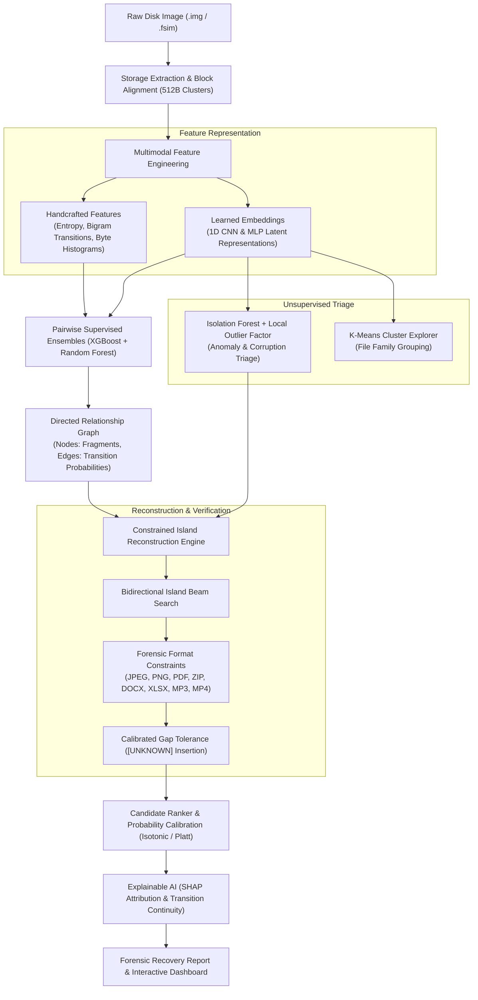

# ForenSight: AI/ML-Driven Digital Forensic Fragment Recovery

<p align="center">
  
</p>

<p align="center">
  <strong>Intelligent Digital Forensic Reconstruction of Fragmented Storage Blocks</strong><br>
  Combining Deep Metric Learning, Graph-Based Inference, Unsupervised Anomaly Triage, and Explainable AI.
</p>

<p align="center">
  
  
  
  
  
  
</p>

---

## 🔍 Overview

When digital storage devices undergo deletion, file system corruption, formatting, or hostile anti-forensic wiping, files frequently become **fragmented**, **interleaved**, and **scattered** across unallocated clusters. 

Conventional carving utilities (such as Foremost, Scalpel, or PhotoRec) depend strictly on static magic numbers, file headers, and footer markers. These traditional signature-based methods fail when:
- Fragments are non-contiguous or interleaved across distant storage sectors.
- File headers or internal markers are corrupted or destroyed.
- Fragments from different files share identical MIME signatures.
- Missing intermediate blocks break sequential byte streams.

**ForenSight** reframes forensic file carving as an **end-to-end Machine Learning and Graph Optimization challenge**. By modeling storage blocks as nodes in a weighted relationship graph and learning fragment affinity through supervised ensembles and deep representation learning, ForenSight reconstructs complex, fragmented digital artifacts with calibrated confidence and transparent explainability.

---

## 🏛️ System Architecture

ForenSight processes raw forensic disk images through a modular, nine-stage pipeline:



---

## ✨ Key Capabilities

### 1. Multimodal Fragment Representation
- **Raw Byte Embeddings**: 1D Convolutional Neural Networks (CNN) and Multi-Layer Perceptrons (MLP) mapping 512-byte blocks into dense 32-dimensional latent vectors.
- **Statistical & Structural Signatures**: 256-bin byte frequency distributions, Shannon entropy, contiguous byte-value delta statistics, and header/footer evidence scores.

### 2. Pairwise Supervised Classifiers
- **Same-File Classification**: Determines whether two arbitrary fragments belong to the same originating file.
- **Next-Fragment Transition**: Predicts the exact directed probability $P(B \mid A)$ that fragment $B$ immediately succeeds fragment $A$.
- **Model Ensembles**: Stacks Gradient Boosted Decision Trees (XGBoost) and Random Forests with hard-negative mining for high-precision boundary discrimination.

### 3. Unsupervised Anomaly & Corruption Triage
- Ensembles **Isolation Forest** and **Local Outlier Factor (LOF)** to score each fragment from $0.00$ to $1.00$.
- Fragments scoring $\ge 0.70$ are flagged as **`SUSPICIOUS`**, highlighting corrupted clusters, bit rot, slack-space contamination, or steganographic payloads.

### 4. Graph-Based Island Reconstruction
- Constructs a directed graph of all fragments filtered by dynamic probability thresholds.
- Utilizes **bidirectional island-driven beam search**, expanding outwards from confirmed file headers and footers while pruning paths that violate forensic grammar.
- Applies calibrated penalty weights for anomalies and structural violations.

### 5. Gap Tolerance & Missing Block Recovery
- When intermediate fragments are destroyed or overwritten, ForenSight identifies broken transition chains and inserts calibrated `[UNKNOWN]` gap tokens, enabling recovery of remaining valid data.

### 6. Probability Calibration & Explainability (XAI)
- **Empirical Calibration**: Maps raw model outputs to true posterior probabilities using Isotonic Regression and Platt scaling, categorizing candidates into **High-Confidence Recovery** ($\ge 85\%$), **Uncertain** ($60\% - 85\%$), and **Low-Confidence** ($< 60\%$).
- **SHAP Feature Attributions**: Provides inspectable rationale for why two fragments were linked or rejected.

### 7. Interactive Modern UI Dashboard
- Built with **Next.js 14**, **TypeScript**, and **FastAPI**.
- Features an interactive **Graph Canvas**, **Hex / Metadata Fragment Inspector**, **Anomaly Heatmap**, **Embedding Manifold Visualizer**, and **Automated Forensic Report Exporter** (Markdown, HTML, JSON).

---

## 📁 Repository Structure

```
ForenSight/
├── api/                     # FastAPI backend application & endpoints
│   └── main.py              # REST API serving analyses, fragments, and graph data
├── frontend/                # Next.js 14 interactive forensic dashboard
│   ├── app/                 # App router pages (fragments, graph, anomalies, etc.)
│   ├── components/          # UI components (GraphCanvas, TopBar, Shell, etc.)
│   └── lib/                 # API client utilities & formatters
├── extraction/              # Forensic disk image parser & synthetic dataset generator
├── features/                # Byte histograms, Shannon entropy, bigram & structural features
├── embeddings/              # Deep metric learning models (CNN & MLP PyTorch encoders)
├── anomaly/                 # Unsupervised anomaly detectors (Isolation Forest & LOF)
├── clustering/              # K-Means clustering and representation manifolds
├── graph/                   # Directed fragment relationship graph builder
├── reconstruction/          # Bidirectional island-driven beam search & constraint validation
├── ranking/                 # Candidate reconstruction scoring & ranking
├── calibration/             # Isotonic & sigmoid confidence calibrators
├── explainability/          # SHAP attribution & forensic decision explainers
├── reports/                 # Markdown, HTML, and JSON report generation engines
├── evaluation/              # Benchmark suites, ablation testing & metrics
├── scripts/                 # CLI entry points (pipeline, analysis, dataset generator)
├── config.py                # Global configuration & path anchors
├── pipeline.py              # End-to-end training and analysis pipeline
├── requirements.txt         # Core Python dependencies
└── .gitignore               # Tailored rules for forensic datasets & environments
```

---

## 🚀 Quick Start Guide

### Prerequisites
- **Python**: `3.10`, `3.11`, or `3.12`
- **Node.js**: `v18.0` or higher (with `npm`)

---

### Step 1: Clone & Setup Backend

```powershell
# Clone the repository
git clone https://github.com/Darth-sader/ForenSight.git
cd ForenSight

# Create and activate a Python virtual environment
python -m venv .venv
.\.venv\Scripts\Activate.ps1   # On Linux/macOS: source .venv/bin/activate

# Install backend dependencies
pip install -r requirements.txt
```

---

### Step 2: Setup Frontend

```powershell
cd frontend
npm install
cd ..
```

---

### Step 3: Launch the Web Application

Run the backend and frontend in separate terminals:

#### **Terminal 1: FastAPI Backend**
```powershell
.\.venv\Scripts\Activate.ps1
python api/main.py
```
- **Backend API**: `http://127.0.0.1:8000`
- **Interactive Swagger Documentation**: `http://127.0.0.1:8000/docs`

#### **Terminal 2: Next.js Frontend**
```powershell
cd frontend
npm run dev
```
- **Dashboard UI**: `http://localhost:3000`
*(API calls to `/api/*` are automatically proxied to port 8000).*

---

## 🛠️ CLI Pipeline Usage

ForenSight can also be fully operated and benchmarked via the command line:

### 1. Generate Synthetic Corpus & Scenario Disk Images
Generates controlled forensic corpora across 8 file types (JPEG, PNG, PDF, ZIP, DOCX, XLSX, MP3, MP4) with simulated fragmentation, corruption, and missing blocks:
```powershell
python scripts/generate_dataset.py
```

### 2. Train the Machine Learning Pipeline
Trains PyTorch encoders, pairwise ensembles, anomaly detectors, and confidence calibrators:
```powershell
python scripts/run_pipeline.py
# Skip cross-validation or hyperparameter tuning for faster runs:
python scripts/run_pipeline.py --no-tune --no-cv
```

### 3. Analyze a Forensic Disk Image
Carve and reconstruct files directly from any raw forensic image:
```powershell
python scripts/analyse_image.py dataset/disk_images/S_A.img Scenario_A
```

---

## 📊 Benchmark Scenarios

ForenSight is evaluated against synthetic and real-world forensic challenge sets:

| Scenario Code | Layout Type | Fragmentation Level | Corruption Rate | Missing Clusters |
| :--- | :--- | :--- | :--- | :--- |
| **`S_A`** | Contiguous | Contiguous (0 interleave) | 0% | 0% |
| **`S_B`** | Low Fragmentation | Low (1 block interleave) | 0% | 0% |
| **`S_C`** | High Fragmentation | High (6 blocks interleave) | 0% | 0% |
| **`S_D01 - S_D20`**| Corrupted Storage | Contiguous | 1% – 20% bit corruption | 0% |
| **`S_E05 - S_E20`**| Missing Blocks | Contiguous | 0% | 5% – 20% missing sectors |
| **`S_H`** | Complex Real-World | Severe (12 block interleave) | 5% corruption | 10% missing sectors |

---

## 📄 License

This project is licensed under the [MIT License](LICENSE).
