# FORENSIGHT: COMPREHENSIVE READ-ONLY TECHNICAL AUDIT REPORT
**Investigation: ML-Assisted Digital Forensic File Reconstruction Framework**
**Audit Date:** 2026-11-22 | **Auditor Role:** Senior Digital Forensics Researcher, ML Research Engineer & Independent Code Auditor
**Operating System Environment:** Windows 10/11 x64 | **Python:** 3.12.x (Virtualenv: `.venv`)
**Target Workspace:** `D:\Projects\ForenSight`

---

## 1. EXECUTIVE TECHNICAL SUMMARY

ForenSight is conceived as an ML-assisted digital forensic file reconstruction framework aiming to investigate whether dual-task fragment relationship learning, deep representation learning, graph-based reconstruction, forensic structural constraints, and calibrated uncertainty can reliably reconstruct fragmented, corrupted, and interleaved files from digital storage media.

This technical audit presents an exhaustive, independent, read-only inspection of the entire codebase, training pipelines, serialized model artifacts, feature engineering suites, underlying datasets, sqlite database records (`forensight.db`), and experimental outputs.

### Key Audit Verdicts
1. **Corpus Reality vs Forensic Authenticity:** The reported 50 original files (spanning 8 formats: JPEG, PNG, PDF, ZIP, DOCX, XLSX, MP3, MP4; 3,538 fragments; 1,798,448 total bytes) are **100% synthetically generated** in code via PIL drawing, string concatenation, elementary zip containers, and synthetic sine waves. There are **zero authentic digital evidence files** or standardized forensic benchmark corpus files (e.g., Govdocs1, DFRWS, or NIST CFTT).
2. **Verification of Model Performance Claims:** The reported validation and holdout metrics in `results/training_summary.json` were **verified verbatim** against the repository artifact records (e.g., Next-fragment RF holdout AUC = `0.9979`, Next-fragment XGBoost holdout AUC = `0.9974`, Same-file RF holdout AUC = `0.9335`, Same-file XGBoost holdout AUC = `0.9299`, Next-fragment ECE calibrated = `0.0022`, Same-file ECE calibrated = `0.0079`, Siamese MLP similarity separation = `0.9117` vs `0.2101`, Siamese CNN similarity separation = `0.9261` vs `0.2938`).
3. **Severe Methodological Flaw — Ground-Truth Offset Leakage:** A critical data leakage mechanism exists in `preprocessing/labels.py` (lines 72-73) and `features/contextual_features.py`: training pairs are assigned `physical_offset = offset_in_source` and `cluster = original_position`. Features `physical_adjacent`, `physical_dist_log`, `physical_close`, and `cluster_dist` directly consume these source offsets. Consequently, consecutive positive fragment pairs are trivially separable via `physical_adjacent == 1.0` during training and evaluation, explaining the near-perfect AUC (`0.998`) while failing to represent real-world non-contiguous fragmentation.
4. **Architectural Discrepancy — 'Dead' Dual-Relation Learning in Reconstruction:** While the framework trains both a same-file classifier (`same_ensemble`) and a next-fragment classifier (`next_ensemble`), during actual image reconstruction inference (`reconstruction/reconstruct.py`, line 139), `same_ensemble` is **completely omitted**. The graph builder is called as `build_relationship_graph(..., scores['calibrated'], scores['calibrated'], ...)`, reusing the next-fragment transition probability for both `p_next` and `p_same`. The dual-relation reconstruction hypothesis is therefore unimplemented in inference.
5. **Uncertainty & Abstention Audit:** Confidence calibration via Platt scaling and Isotonic regression is implemented, but true conformal prediction and decision-theoretic abstention gates (refusing to commit reconstruction hypotheses below an error-controlled risk bound) are **absent**. Candidate confidence is subsequently corrupted by heuristic arithmetic subtractions (`confidence = clip(raw_conf - 0.1*violations - 0.08*overlap, 0, 1)`).
6. **Forensic Validation Depth:** Validation is limited to lightweight magic number matching and heuristic string counters (`reconstruction/constraints.py`). There is no AST syntax parsing, DEFLATE decompression validation, JPEG Huffman/quantization table parsing, or byte-perfect integrity verification.
7. **Database Audit Discrepancy:** While 11 scenario analyses are persisted in `forensight.db`, their `metrics` fields are all completely empty (`{}`). This occurred because images uploaded via the REST API (`api/main.py`) prepended UUID prefixes (`cb0c05b6_S_D20.fsim`), causing `_truth_for()` in `pipeline.py` to fail exact filename stem matching against `dataset/scenarios/`.

## 2. REPOSITORY ARCHITECTURE

### Directory Tree
```
D:\Projects\ForenSight
├── anomaly/                     # Unsupervised anomaly triage (Isolation Forest, LOF, OCSVM)
│   ├── isolation_forest.py      # IsolationForestDetector, LOFDetector, OneClassSVMDetector
│   ├── lof.py                   # Re-exports LOFDetector and OneClassSVMDetector
│   └── __init__.py              # Anomaly package exports
├── api/                         # FastAPI backend REST application
│   └── main.py                  # API endpoints, image upload, async background execution
├── artifacts/                   # Serialized ML model weights, encoders, and calibrators
│   ├── confidence_calibrator.joblib
│   ├── encoder_cnn.pt           # RawByteCNN PyTorch weights (32-dim latent space)
│   ├── encoder_mlp.pt           # FragmentEncoder PyTorch weights (32-dim latent space)
│   ├── file_size_stats.joblib   # Format-level size percentiles (p10, median, p90)
│   ├── next_calibrator.joblib   # Isotonic/Platt calibrator for next-fragment transitions
│   ├── next_ensemble.joblib     # TransitionEnsemble (RF, XGBoost, MLP, Logistic)
│   ├── ranker.joblib            # CandidateRanker logistic meta-model
│   ├── same_calibrator.joblib   # Isotonic/Platt calibrator for same-file classification
│   └── same_ensemble.joblib     # Same-file TransitionEnsemble
├── calibration/                 # Confidence and probability calibration
│   ├── confidence.py            # PlattCalibrator, IsotonicCalibrator, ECE, Brier score
│   └── __init__.py
├── clustering/                  # Representation clustering and manifold exploration
│   ├── dbscan.py                # Re-exports DBSCANClusterer
│   ├── kmeans.py                # KMeansClusterer with silhouette selection, Agglomerative
│   └── __init__.py
├── database/                    # SQLAlchemy persistence layer
│   ├── models.py                # Analysis, FragmentRow, CandidateRow, ExperimentRow ORM
│   ├── service.py               # Session CRUD, result bundle serialization
│   └── __init__.py
├── dataset/                     # Synthetic forensic data artifacts
│   ├── disk_images/             # Raw (.img) and ForenSight (.fsim) image files
│   ├── fragments/blobs/         # 3,538 individual fragment files (F00001.bin - F03538.bin)
│   ├── ground_truth/            # Ground truth tables (files.csv, fragments.csv)
│   ├── original_files/          # 50 synthesized source files
│   └── scenarios/               # Per-scenario manifests and placements.csv (S_A - S_H, SWEEPS)
├── embeddings/                  # Metric learning embeddings and fusion
│   ├── similarity.py            # FragmentEmbedder, FusedEmbedder, pair_similarities
│   └── __init__.py
├── evaluation/                  # Metrics, benchmarking, and cross-validation
│   ├── ablation.py              # Cumulative feature family ablation (experiments A-E)
│   ├── benchmarks.py            # SignatureCarver baseline and component benchmarks
│   ├── cross_validation.py      # StratifiedKFold and GroupKFold by source file
│   ├── experiments.py           # ExperimentRunner for sweeps (frag, corr, missing, decoys)
│   ├── metrics.py               # Classification, reconstruction, topk, ranking, anomaly metrics
│   └── __init__.py
├── explainability/              # Explainable AI (XAI)
│   ├── feature_importance.py    # Permutation importance, tree feature importance, SHAP wrapper
│   ├── shap_analysis.py         # Pairwise decision drivers and global SHAP summaries
│   └── __init__.py
├── extraction/                  # Disk image parsing and synthetic corpus generator
│   ├── dataset_generator.py     # CorpusBuilder, ScenarioImageWriter, synthetic file synthesis
│   ├── filesystem_parser.py     # DiskImageParser (FSIM, RAW, optional pytsk3 fallback)
│   ├── fragment_extractor.py    # extract_fragments (512B cluster parsing, corruption)
│   └── __init__.py
├── features/                    # Multimodal 362-feature engineering suite
│   ├── byte_features.py         # 256-bin byte histogram, mean, variance, min, max, entropy
│   ├── contextual_features.py   # Physical offsets, cluster indices, allocation status
│   ├── local_entropy.py         # Sliding-window local entropy (window=64, stride=32, 15-d profile)
│   ├── pair_features.py         # Boundary continuity, histogram distances, pair interaction
│   ├── statistical_features.py  # Printable ratio, byte diversity, 32-d hashed 2/3-grams
│   ├── structural_features.py   # Magic bytes, header/footer/internal markers for 8 formats
│   └── __init__.py              # FeatureEngine, PAIR_NAMES (362), single_matrix_ (400)
├── frontend/                    # Next.js 14 TypeScript user dashboard
├── graph/                       # Graph construction and search algorithms
│   ├── graph_inference.py       # CandidatePath, beam_search, backward_beam_search, island_partition
│   ├── path_optimizer.py        # path_components, combined_score, greedy_baseline_path
│   ├── relationship_graph.py    # build_relationship_graph (NetworkX DiGraph), top-K successors
│   └── __init__.py
├── models/                      # Predictive models and deep architectures
│   ├── base.py                  # Abstract model interfaces
│   ├── cnn_encoder.py           # RawByteCNN, SiameseCNN 1D convolutional metric encoder
│   ├── logistic.py              # LogisticModel (Pipeline with StandardScaler)
│   ├── mlp.py                   # PairMLP, MLPTorchModel (PyTorch binary pair classifier)
│   ├── random_forest.py         # RandomForestModel (scikit-learn wrapper)
│   ├── siamese.py               # FragmentEncoder, SiameseNetwork MLP metric encoder
│   ├── xgboost.py               # XGBoostModel (XGBClassifier wrapper)
│   └── __init__.py              # TransitionEnsemble AUC-weighted ensemble
├── optimization/                # Hyperparameter tuning
│   ├── hyperparameter_search.py # Grid search, random search, GP Bayesian search surrogate
│   └── __init__.py
├── preprocessing/               # Dataset assembly and class balancing
│   ├── labels.py                # CorpusPairBuilder (corruption augmentation, train/val split)
│   ├── normalize.py             # FeatureNormalizer (StandardScaler / MinMaxScaler wrapper)
│   ├── sampling.py              # generate_pairs, hard negative mining, PairDataset, SMOTE
│   └── __init__.py
├── ranking/                     # Global candidate hypothesis ranking
│   ├── candidate_ranker.py      # CandidateRanker (learning-to-rank logistic meta-model)
│   └── __init__.py
├── reconstruction/              # Reconstruction engine and forensic constraints
│   ├── constraints.py           # ForensicConstraints (header/footer, order, format consistency)
│   ├── reconstruct.py           # ReconstructionEngine (pipeline orchestrator for image analysis)
│   └── __init__.py
├── reports/                     # Report generation engine (TXT, JSON, HTML)
│   ├── report_generator.py      # candidate_to_text, generate_reports
│   └── __init__.py
├── results/                     # Experimental metric outputs and visualization plots
│   ├── plots/                   # Saved PNG visualization plots
│   └── training_summary.json    # Complete JSON metrics record of training run
├── common.py                    # Dataclasses (Fragment, PairSample, ReconstructionCandidate), logger
├── config.py                    # Global constants, directory anchors, hyperparameter defaults
├── forensight.db                # SQLite results database (analyses, fragments, candidates)
├── pipeline.py                  # CLI orchestration entry point (train_all, analyse_image)
└── requirements.txt             # Python dependency specification
```

### System Execution Flow Diagram

```mermaid
flowchart TD
    subgraph Input [Forensic Storage Ingestion]
        RAW["Raw Disk Image (.img / .fsim)"] --> PARSER["DiskImageParser\n(extraction/filesystem_parser.py)"]
        PARSER --> EXTRACT["extract_fragments()\n(extraction/fragment_extractor.py)"]
        EXTRACT --> BLOCKS["Fixed 512B Block Fragments\n+ Filesystem Metadata Context"]
    end

    subgraph Repr [Multimodal Feature Extraction]
        BLOCKS --> FE["FeatureEngine\n(features/__init__.py)"]
        FE --> S_MAT["Single-Fragment Matrix (400 dims)\n(Byte, Stat, Struct, Context)"]
        BLOCKS --> CNN_IN["Raw Byte Matrix (512 dims)"]
    end

    subgraph Encoders [Metric Learning Encoders]
        S_MAT --> ENC_MLP["Siamese MLP Encoder\n(models/siamese.py) -> 32D Latent"]
        CNN_IN --> ENC_CNN["Siamese 1D CNN Encoder\n(models/cnn_encoder.py) -> 32D Latent"]
        ENC_MLP --> FUSED["FusedEmbedder\n(embeddings/similarity.py)"]
        ENC_CNN --> FUSED
    end

    subgraph Pairwise [Pairwise Relationship Inference]
        FUSED --> KNN["Fused KNN Candidate Generation\n(k=8 successors per fragment)"]
        KNN --> PAIR_VEC["FeatureEngine.pair_matrix_vec()\n362 Pairwise Features"]
        PAIR_VEC --> ENS["TransitionEnsemble (next_ensemble)\n(XGBoost + RF + MLP + Logistic)"]
        ENS --> CALIB["Isotonic / Platt Calibrator\n(calibration/confidence.py)"]
        CALIB --> P_NEXT["Calibrated Transition Probability P(B|A)"]
    end

    subgraph Anomaly [Unsupervised Anomaly Triage]
        FUSED --> IF_LOF["Isolation Forest + LOF\n(anomaly/isolation_forest.py)"]
        IF_LOF --> ANOM_SCORE["Anomaly Score in [0, 1]\n(Flag >= 0.70 Suspicious)"]
    end

    subgraph GraphRec [Graph Construction & Inference]
        P_NEXT --> GRAPH["Directed Relationship Graph\n(graph/relationship_graph.py: Top-5 Edges)"]
        ANOM_SCORE --> GRAPH
        GRAPH --> ISLAND["Island Partitioning (p_next >= 0.50)\n(graph/graph_inference.py)"]
        ISLAND --> BEAM["Bidirectional Beam Search\n(Forward from Headers, Backward from Footers)"]
        BEAM --> STITCH["Stitch Paths & Insert [UNKNOWN] Gaps"]
    end

    subgraph Validation [Constraints & Ranking]
        STITCH --> CONSTR["ForensicConstraints.check()\n(reconstruction/constraints.py)"]
        CONSTR --> RANKER["CandidateRanker Meta-Model\n(ranking/candidate_ranker.py)"]
        RANKER --> OUTPUT["Ranked Reconstruction Candidates\n(High-Conf, Uncertain, Low-Conf)"]
    end
```



## 3. DATASET AND GROUND-TRUTH SPECIFICATION

The ForenSight dataset is located in `dataset/` and was synthesized using `extraction/dataset_generator.py`. The ground truth metadata resides in `dataset/ground_truth/files.csv` and `dataset/ground_truth/fragments.csv`.

### 3.1 Corpus Quantities and Physical Parameters
- **Total Original Files:** 50 files (**VERIFIED** in `dataset/original_files/` and `dataset/ground_truth/files.csv`).
- **Total Corpus Size:** 1,798,448 bytes (~1.72 MB) (**VERIFIED** across all 50 files).
- **Total Canonical Fragments:** 3,538 fragments (**VERIFIED** in `dataset/fragments/blobs/` and `fragments.csv`).
- **Nominal Fragment Granularity:** 512 bytes (`FRAGMENT_SIZE = 512` in `config.py`, line 37).
- **Block Granularity Reality:** 3,488 fragments are exactly 512 bytes. 50 fragments are partial tail blocks representing the final bytes of each file, with sizes ranging from 3 bytes (`photo05.jpeg` tail) to 512 bytes (exact multiples). Partial blocks are stored unpadded in `dataset/fragments/blobs/` and zero-padded to 512 bytes during pair dataset assembly in `preprocessing/labels.py` (line 30).
- **Partition Split:** 37 Training Files (74%) and 13 Held-out Files (26%) (**VERIFIED**; governed by `HOLDOUT_FILE_FRACTION = 0.25` in `config.py`, line 54).

### 3.2 Breakdown by Format
| File Format | Extension | Total Files | Total Bytes | Total Fragments | Train Files | Holdout Files | Synthesis Implementation |
| :--- | :--- | :--- | :--- | :--- | :--- | :--- | :--- |
| **DOCX** | `.docx` | 6 | 21,144 B | 43 | 4 | 2 | Python zipfile.ZipFile containing [Content_Types].xml, _rels/.rels, and word/document.xml with synthetic paragraphs |
| **JPEG** | `.jpeg` | 10 | 150,109 B | 299 | 8 | 2 | PIL ImageDraw RGB with gradient backgrounds and random colored ellipses |
| **MP3** | `.mp3` | 4 | 399,371 B | 782 | 3 | 1 | Synthetic ID3v2 header tag plus synthetic sine wave audio (sin tones) packed into 417-byte MPEG-1 Layer III frames |
| **MP4** | `.mp4` | 4 | 497,804 B | 974 | 3 | 1 | Synthesized ISO base media file format with ftyp box, mdat box containing random NALU bytes (0x00000001419a), and basic moov/mvhd/trak |
| **PDF** | `.pdf` | 8 | 415,969 B | 817 | 6 | 2 | Synthetic PDF 1.4 string generation with basic obj, stream, xref, and trailer containing random word chunks |
| **PNG** | `.png` | 8 | 225,081 B | 444 | 6 | 2 | PIL ImageDraw RGB with vertical line gradients |
| **XLSX** | `.xlsx` | 4 | 26,110 B | 53 | 3 | 1 | Python zipfile.ZipFile containing [Content_Types].xml, _rels/.rels, xl/workbook.xml, and sheet1.xml with float cell values |
| **ZIP** | `.zip` | 6 | 62,860 B | 126 | 4 | 2 | Python zipfile.ZipFile deflated containing random CSV rows and random notes text |

### 3.3 File Synthesis Methodology
Every file in ForenSight is synthesized programmatically by `extraction/dataset_generator.py`:
1. **JPEG (10 files):** Synthesized via PIL (`make_jpeg`, lines 42-71). Generates a 240x240 RGB canvas with color gradients and 6-14 random ellipses. In 'similar content' mode (even files), it perturbs a shared base canvas (`_jpeg_bases`). Quality is iteratively stepped from 85 to 97 until target byte length is reached.
2. **PNG (8 files):** Synthesized via PIL (`make_png`, lines 74-91). Generates a variable-dimension RGB image (96-220 px) with vertical gradient stripes and 4-10 overlaid random lines.
3. **PDF (8 files):** Synthesized via Python string formatting (`make_pdf`, lines 93-134). Writes standard `%PDF-1.4` headers, catalog, page dictionaries, and stream objects embedding chunks of synthetic dictionary words (`_WORDS`). Includes a synthetic cross-reference table (`xref`) and `trailer`.
4. **ZIP (6 files):** Synthesized via `zipfile.ZipFile` (`make_zip`, lines 136-150). Contains 4-8 synthetic files: pseudo-CSV data rows, synthetic text notes, and a random binary blob (`blob.bin`).
5. **DOCX (6 files):** Synthesized via `zipfile.ZipFile` (`make_docx`, lines 164-177). Embeds `[Content_Types].xml`, `_rels/.rels`, and `word/document.xml` containing synthetic XML paragraph tags (`<w:p><w:r><w:t>`).
6. **XLSX (4 files):** Synthesized via `zipfile.ZipFile` (`make_xlsx`, lines 179-204). Embeds `[Content_Types].xml`, `_rels/.rels`, `xl/workbook.xml`, and `xl/worksheets/sheet1.xml` containing numeric float strings in grid cells.
7. **MP3 (4 files):** Synthesized programmatically (`make_mp3`, lines 207-221). Emits an ID3v2 header tag with title payload, followed by synthetic sine wave tones (`np.sin(t / 7.0 + phase) * 60 + ...`) packetized into 417-byte MPEG-1 Layer III frames prefixed with `\xff\xfb\x90\x00`.
8. **MP4 (4 files):** Synthesized programmatically (`make_mp4`, lines 223-237). Emits standard ISO BMFF boxes: `ftyp` (isom/mp41), `mdat` (containing random bytes preceded by H.264 NALU start codes `\x00\x00\x00\x01\x41\x9a`), and minimal `moov`/`mvhd`/`trak` metadata boxes.

### 3.4 Forensic Storage Simulation (FSIM) & Scenario Generation
Scenario disk images (`dataset/disk_images/`) are rendered using `ScenarioImageWriter.build_image` (`extraction/dataset_generator.py`, lines 363-536):
- **Superblock & Header Region:** Blocks 0-7 are reserved for the FSIM superblock (`FSIM0001` magic, total blocks, block size 512, volume ID). Blocks 8-71 hold the cluster allocation bitmap (1 bit per cluster). Data clusters begin at cluster index 72.
- **Interleaving & Fragmentation Layouts:** Controlled by `FRAGMENTATION_INTERLEAVE` (`config.py`, line 62):
  - `contiguous` (S_A): 0 interleave noise blocks.
  - `low` (S_B): 1 noise block inserted between consecutive file fragments (randomized 85% probability).
  - `medium`: 3 noise blocks.
  - `high` (S_C): 6 noise blocks inserted between consecutive fragments.
  - `severe` (S_H): 12 noise blocks inserted between consecutive fragments.
  - `mixed` (S_F): Round-robin cluster interleaving across multiple files simultaneously.
- **Corruption Methodology:** Controlled by `CORRUPTION_LEVELS = [0.01, 0.05, 0.10, 0.20]`. In scenario images and training pair augmentation, `round(fragment_size * pct)` random byte positions are selected and overwritten with `rng.randbytes()` noise.
- **Missing-Block Methodology:** Controlled by `MISSING_LEVELS = [0.05, 0.10, 0.20]`. Intermediate non-edge fragments (`original_position not in (0, len-1)`) are excised with probability `pct`. Their physical offset is recorded as `-1` in `placements.csv`, simulating cluster overwrites or unrecoverable sectors.
- **Decoy Fragments:** In scenario `SWEEP_DECOYS` and `S_H`, up to 20 fragments from external files of the same format (not belonging to the active scenario files) are injected into unallocated/slack clusters to evaluate candidate ambiguity.

## 4. COMPLETE FEATURE DICTIONARY

ForenSight extracts **362 pairwise features** for every fragment pair `(A, B)` to predict adjacency ($P(B \mid A)$) and membership ($P(\text{same file})$). The features are defined in `features/` and indexed in `features/__init__.py` (`PAIR_NAMES`).

### Feature Family Summary
| Family | Count | Dimension Range | Primary Extraction Source | Forensic Target |
| :--- | :---: | :---: | :--- | :--- |
| **byte** | 267 | 0 - 266 | `features/byte_features.py` | 256-d histogram delta, L1/Cosine/Chi2 dist, scalar stats |
| **statistical** | 27 | 267 - 293 | `features/statistical_features.py`, `features/local_entropy.py` | Entropy delta, printable ratios, 32-d hashed 2/3-grams, local entropy profile |
| **structural** | 46 | 294 - 339 | `features/structural_features.py` | Header/footer/internal markers for 8 formats, format consistency, cross-format conflicts |
| **boundary** | 6 | 340 - 345 | `features/pair_features.py` | Byte continuity across $A[-1] \to B[0]$, prefix/suffix overlap, format transition rules |
| **context** | 16 | 346 - 361 | `features/contextual_features.py`, `features/pair_features.py` | Physical block distance, cluster proximity, filesystem allocation status matching |
| **TOTAL** | **362** | **0 - 361** | `features/__init__.py` | Complete pairwise representation vector |

### Full Specification of All 362 Features
| Idx | Feature Name | Group | Mathematical / Computational Definition | Extraction Function | Output Type | Leakage Risk Assessment |
| :--- | :--- | :--- | :--- | :--- | :--- | :--- |
| 0 | `hist_absdiff_0` | `byte` | |Hist_A[0] - Hist_B[0]| (absolute difference of normalised byte frequency for byte value 0) | `FeatureEngine.pair_matrix_vec / np.abs(ha - hb)` | `float32 [0.0, 1.0]` | None (derived purely from fragment byte payload) |
| 1 | `hist_absdiff_1` | `byte` | |Hist_A[1] - Hist_B[1]| (absolute difference of normalised byte frequency for byte value 1) | `FeatureEngine.pair_matrix_vec / np.abs(ha - hb)` | `float32 [0.0, 1.0]` | None (derived purely from fragment byte payload) |
| 2 | `hist_absdiff_2` | `byte` | |Hist_A[2] - Hist_B[2]| (absolute difference of normalised byte frequency for byte value 2) | `FeatureEngine.pair_matrix_vec / np.abs(ha - hb)` | `float32 [0.0, 1.0]` | None (derived purely from fragment byte payload) |
| 3 | `hist_absdiff_3` | `byte` | |Hist_A[3] - Hist_B[3]| (absolute difference of normalised byte frequency for byte value 3) | `FeatureEngine.pair_matrix_vec / np.abs(ha - hb)` | `float32 [0.0, 1.0]` | None (derived purely from fragment byte payload) |
| 4 | `hist_absdiff_4` | `byte` | |Hist_A[4] - Hist_B[4]| (absolute difference of normalised byte frequency for byte value 4) | `FeatureEngine.pair_matrix_vec / np.abs(ha - hb)` | `float32 [0.0, 1.0]` | None (derived purely from fragment byte payload) |
| 5 | `hist_absdiff_5` | `byte` | |Hist_A[5] - Hist_B[5]| (absolute difference of normalised byte frequency for byte value 5) | `FeatureEngine.pair_matrix_vec / np.abs(ha - hb)` | `float32 [0.0, 1.0]` | None (derived purely from fragment byte payload) |
| 6 | `hist_absdiff_6` | `byte` | |Hist_A[6] - Hist_B[6]| (absolute difference of normalised byte frequency for byte value 6) | `FeatureEngine.pair_matrix_vec / np.abs(ha - hb)` | `float32 [0.0, 1.0]` | None (derived purely from fragment byte payload) |
| 7 | `hist_absdiff_7` | `byte` | |Hist_A[7] - Hist_B[7]| (absolute difference of normalised byte frequency for byte value 7) | `FeatureEngine.pair_matrix_vec / np.abs(ha - hb)` | `float32 [0.0, 1.0]` | None (derived purely from fragment byte payload) |
| 8 | `hist_absdiff_8` | `byte` | |Hist_A[8] - Hist_B[8]| (absolute difference of normalised byte frequency for byte value 8) | `FeatureEngine.pair_matrix_vec / np.abs(ha - hb)` | `float32 [0.0, 1.0]` | None (derived purely from fragment byte payload) |
| 9 | `hist_absdiff_9` | `byte` | |Hist_A[9] - Hist_B[9]| (absolute difference of normalised byte frequency for byte value 9) | `FeatureEngine.pair_matrix_vec / np.abs(ha - hb)` | `float32 [0.0, 1.0]` | None (derived purely from fragment byte payload) |
| 10 | `hist_absdiff_10` | `byte` | |Hist_A[10] - Hist_B[10]| (absolute difference of normalised byte frequency for byte value 10) | `FeatureEngine.pair_matrix_vec / np.abs(ha - hb)` | `float32 [0.0, 1.0]` | None (derived purely from fragment byte payload) |
| 11 | `hist_absdiff_11` | `byte` | |Hist_A[11] - Hist_B[11]| (absolute difference of normalised byte frequency for byte value 11) | `FeatureEngine.pair_matrix_vec / np.abs(ha - hb)` | `float32 [0.0, 1.0]` | None (derived purely from fragment byte payload) |
| 12 | `hist_absdiff_12` | `byte` | |Hist_A[12] - Hist_B[12]| (absolute difference of normalised byte frequency for byte value 12) | `FeatureEngine.pair_matrix_vec / np.abs(ha - hb)` | `float32 [0.0, 1.0]` | None (derived purely from fragment byte payload) |
| 13 | `hist_absdiff_13` | `byte` | |Hist_A[13] - Hist_B[13]| (absolute difference of normalised byte frequency for byte value 13) | `FeatureEngine.pair_matrix_vec / np.abs(ha - hb)` | `float32 [0.0, 1.0]` | None (derived purely from fragment byte payload) |
| 14 | `hist_absdiff_14` | `byte` | |Hist_A[14] - Hist_B[14]| (absolute difference of normalised byte frequency for byte value 14) | `FeatureEngine.pair_matrix_vec / np.abs(ha - hb)` | `float32 [0.0, 1.0]` | None (derived purely from fragment byte payload) |
| 15 | `hist_absdiff_15` | `byte` | |Hist_A[15] - Hist_B[15]| (absolute difference of normalised byte frequency for byte value 15) | `FeatureEngine.pair_matrix_vec / np.abs(ha - hb)` | `float32 [0.0, 1.0]` | None (derived purely from fragment byte payload) |
| 16 | `hist_absdiff_16` | `byte` | |Hist_A[16] - Hist_B[16]| (absolute difference of normalised byte frequency for byte value 16) | `FeatureEngine.pair_matrix_vec / np.abs(ha - hb)` | `float32 [0.0, 1.0]` | None (derived purely from fragment byte payload) |
| 17 | `hist_absdiff_17` | `byte` | |Hist_A[17] - Hist_B[17]| (absolute difference of normalised byte frequency for byte value 17) | `FeatureEngine.pair_matrix_vec / np.abs(ha - hb)` | `float32 [0.0, 1.0]` | None (derived purely from fragment byte payload) |
| 18 | `hist_absdiff_18` | `byte` | |Hist_A[18] - Hist_B[18]| (absolute difference of normalised byte frequency for byte value 18) | `FeatureEngine.pair_matrix_vec / np.abs(ha - hb)` | `float32 [0.0, 1.0]` | None (derived purely from fragment byte payload) |
| 19 | `hist_absdiff_19` | `byte` | |Hist_A[19] - Hist_B[19]| (absolute difference of normalised byte frequency for byte value 19) | `FeatureEngine.pair_matrix_vec / np.abs(ha - hb)` | `float32 [0.0, 1.0]` | None (derived purely from fragment byte payload) |
| 20 | `hist_absdiff_20` | `byte` | |Hist_A[20] - Hist_B[20]| (absolute difference of normalised byte frequency for byte value 20) | `FeatureEngine.pair_matrix_vec / np.abs(ha - hb)` | `float32 [0.0, 1.0]` | None (derived purely from fragment byte payload) |
| 21 | `hist_absdiff_21` | `byte` | |Hist_A[21] - Hist_B[21]| (absolute difference of normalised byte frequency for byte value 21) | `FeatureEngine.pair_matrix_vec / np.abs(ha - hb)` | `float32 [0.0, 1.0]` | None (derived purely from fragment byte payload) |
| 22 | `hist_absdiff_22` | `byte` | |Hist_A[22] - Hist_B[22]| (absolute difference of normalised byte frequency for byte value 22) | `FeatureEngine.pair_matrix_vec / np.abs(ha - hb)` | `float32 [0.0, 1.0]` | None (derived purely from fragment byte payload) |
| 23 | `hist_absdiff_23` | `byte` | |Hist_A[23] - Hist_B[23]| (absolute difference of normalised byte frequency for byte value 23) | `FeatureEngine.pair_matrix_vec / np.abs(ha - hb)` | `float32 [0.0, 1.0]` | None (derived purely from fragment byte payload) |
| 24 | `hist_absdiff_24` | `byte` | |Hist_A[24] - Hist_B[24]| (absolute difference of normalised byte frequency for byte value 24) | `FeatureEngine.pair_matrix_vec / np.abs(ha - hb)` | `float32 [0.0, 1.0]` | None (derived purely from fragment byte payload) |
| ... | *[Features 25 to 255: `hist_absdiff_25` through `hist_absdiff_255`]* | `byte` | `|Hist_A[d] - Hist_B[d]|` for each byte value $d \in [25, 255]$ | `FeatureEngine.pair_matrix_vec` | `float32 [0.0, 1.0]` | None (pure payload derivative) |
| 256 | `hist_l1` | `byte` | 0.5 * sum(|Hist_A - Hist_B|) (Total Variation / L1 distance between byte frequency distributions) | `features.pair_features.hist_distances / 0.5 * sum(|ha - hb|)` | `float32 [0.0, 1.0]` | None |
| 257 | `hist_cosine_sim` | `byte` | dot(Hist_A, Hist_B) / (||Hist_A|| * ||Hist_B|| + eps) (Cosine similarity of byte histograms) | `features.pair_features.hist_distances / _cosine` | `float32 [0.0, 1.0]` | None |
| 258 | `hist_chi2` | `byte` | min(1.0, (1/256) * sum((Hist_A - Hist_B)^2 / (Hist_A + Hist_B + 1e-6))) (Chi-Square histogram distance) | `features.pair_features.hist_distances` | `float32 [0.0, 1.0]` | None |
| 259 | `d_mean` | `byte` | mean(A) - mean(B) (Difference in byte mean) | `FeatureEngine.pair_matrix_vec / compute_byte_matrix` | `float32` | None |
| 260 | `d_variance` | `byte` | variance(A) - variance(B) (Difference in byte variance) | `FeatureEngine.pair_matrix_vec / compute_byte_matrix` | `float32` | None |
| 261 | `d_min` | `byte` | min(A) - min(B) (Difference in byte min) | `FeatureEngine.pair_matrix_vec / compute_byte_matrix` | `float32` | None |
| 262 | `d_max` | `byte` | max(A) - max(B) (Difference in byte max) | `FeatureEngine.pair_matrix_vec / compute_byte_matrix` | `float32` | None |
| 263 | `d_entropy` | `byte` | entropy(A) - entropy(B) (Difference in byte entropy) | `FeatureEngine.pair_matrix_vec / compute_byte_matrix` | `float32` | None |
| 264 | `p_mean` | `byte` | mean(A) * mean(B) (Product of byte mean) | `FeatureEngine.pair_matrix_vec / compute_byte_matrix` | `float32` | None |
| 265 | `p_variance` | `byte` | variance(A) * variance(B) (Product of byte variance) | `FeatureEngine.pair_matrix_vec / compute_byte_matrix` | `float32` | None |
| 266 | `p_entropy` | `byte` | entropy(A) * entropy(B) (Product of byte entropy) | `FeatureEngine.pair_matrix_vec / compute_byte_matrix` | `float32` | None |
| 267 | `entropy_diff` | `statistical` | Entropy(A) - Entropy(B) (Shannon entropy difference) | `FeatureEngine.pair_matrix_vec` | `float32 [-8.0, 8.0]` | None |
| 268 | `d_printable_ratio` | `statistical` | printable_ratio(A) - printable_ratio(B) | `FeatureEngine.pair_matrix_vec / compute_statistical_matrix` | `float32` | None |
| 269 | `d_ascii_ratio` | `statistical` | ascii_ratio(A) - ascii_ratio(B) | `FeatureEngine.pair_matrix_vec / compute_statistical_matrix` | `float32` | None |
| 270 | `d_zero_ratio` | `statistical` | zero_ratio(A) - zero_ratio(B) | `FeatureEngine.pair_matrix_vec / compute_statistical_matrix` | `float32` | None |
| 271 | `d_high_byte_ratio` | `statistical` | high_byte_ratio(A) - high_byte_ratio(B) | `FeatureEngine.pair_matrix_vec / compute_statistical_matrix` | `float32` | None |
| 272 | `d_byte_diversity` | `statistical` | byte_diversity(A) - byte_diversity(B) | `FeatureEngine.pair_matrix_vec / compute_statistical_matrix` | `float32` | None |
| 273 | `d_top_byte_freq` | `statistical` | top_byte_freq(A) - top_byte_freq(B) | `FeatureEngine.pair_matrix_vec / compute_statistical_matrix` | `float32` | None |
| 274 | `d_repeat_run_ratio` | `statistical` | repeat_run_ratio(A) - repeat_run_ratio(B) | `FeatureEngine.pair_matrix_vec / compute_statistical_matrix` | `float32` | None |
| 275 | `d_bigram_entropy` | `statistical` | bigram_entropy(A) - bigram_entropy(B) | `FeatureEngine.pair_matrix_vec / compute_statistical_matrix` | `float32` | None |
| 276 | `d_le_mean` | `statistical` | le_mean(A) - le_mean(B) | `FeatureEngine.pair_matrix_vec / compute_statistical_matrix` | `float32` | None |
| 277 | `d_le_std` | `statistical` | le_std(A) - le_std(B) | `FeatureEngine.pair_matrix_vec / compute_statistical_matrix` | `float32` | None |
| 278 | `d_le_min` | `statistical` | le_min(A) - le_min(B) | `FeatureEngine.pair_matrix_vec / compute_statistical_matrix` | `float32` | None |
| 279 | `d_le_max` | `statistical` | le_max(A) - le_max(B) | `FeatureEngine.pair_matrix_vec / compute_statistical_matrix` | `float32` | None |
| 280 | `d_le_range` | `statistical` | le_range(A) - le_range(B) | `FeatureEngine.pair_matrix_vec / compute_statistical_matrix` | `float32` | None |
| 281 | `d_le_gradient` | `statistical` | le_gradient(A) - le_gradient(B) | `FeatureEngine.pair_matrix_vec / compute_statistical_matrix` | `float32` | None |
| 282 | `d_le_peak_ratio` | `statistical` | le_peak_ratio(A) - le_peak_ratio(B) | `FeatureEngine.pair_matrix_vec / compute_statistical_matrix` | `float32` | None |
| 283 | `d_le_max_pos` | `statistical` | le_max_pos(A) - le_max_pos(B) | `FeatureEngine.pair_matrix_vec / compute_statistical_matrix` | `float32` | None |
| 284 | `d_le_head` | `statistical` | le_head(A) - le_head(B) | `FeatureEngine.pair_matrix_vec / compute_statistical_matrix` | `float32` | None |
| 285 | `d_le_tail` | `statistical` | le_tail(A) - le_tail(B) | `FeatureEngine.pair_matrix_vec / compute_statistical_matrix` | `float32` | None |
| 286 | `d_le_low_entropy_fraction` | `statistical` | le_low_entropy_fraction(A) - le_low_entropy_fraction(B) | `FeatureEngine.pair_matrix_vec / compute_statistical_matrix` | `float32` | None |
| 287 | `p_printable` | `statistical` | PrintableRatio(A) * PrintableRatio(B) | `FeatureEngine.pair_matrix_vec` | `float32 [0.0, 1.0]` | None |
| 288 | `ngram2_cosine` | `statistical` | Cosine similarity between 32-dim hashed 2-gram frequency vectors of A and B | `features.statistical_features.ngram_vector + _cosine` | `float32 [0.0, 1.0]` | None |
| 289 | `ngram3_cosine` | `statistical` | Cosine similarity between 32-dim hashed 3-gram frequency vectors of A and B | `features.statistical_features.ngram_vector + _cosine` | `float32 [0.0, 1.0]` | None |
| 290 | `le_profile_cosine` | `statistical` | Cosine similarity between 15-dim resampled local entropy profiles of A and B | `features.local_entropy.local_entropy_pair_features` | `float32 [0.0, 1.0]` | None |
| 291 | `le_boundary_diff` | `statistical` | |TailEntropy(A) - HeadEntropy(B)| (Absolute difference between last window of A and first window of B) | `features.local_entropy.local_entropy_pair_features` | `float32 [0.0, 8.0]` | None |
| 292 | `le_boundary_continuity` | `statistical` | clip(1.0 - |TailEntropy(A) - HeadEntropy(B)| / 4.0, 0.0, 1.0) (Boundary entropy transition smoothness) | `features.local_entropy.local_entropy_pair_features` | `float32 [0.0, 1.0]` | None |
| 293 | `le_similar_structure` | `statistical` | float(|MeanLocalEntropy(A) - MeanLocalEntropy(B)| < 0.75) (Indicator of structural entropy affinity) | `features.local_entropy.local_entropy_pair_features` | `float32 {0.0, 1.0}` | None |
| 294 | `d_header_JPEG` | `structural` | header_JPEG(A) - header_JPEG(B) (Difference in header_JPEG score) | `FeatureEngine.pair_matrix_vec / compute_structural_matrix` | `float32 [-1.0, 1.0]` | None |
| 295 | `d_footer_JPEG` | `structural` | footer_JPEG(A) - footer_JPEG(B) (Difference in footer_JPEG score) | `FeatureEngine.pair_matrix_vec / compute_structural_matrix` | `float32 [-1.0, 1.0]` | None |
| 296 | `d_internal_JPEG` | `structural` | internal_JPEG(A) - internal_JPEG(B) (Difference in internal_JPEG score) | `FeatureEngine.pair_matrix_vec / compute_structural_matrix` | `float32 [-1.0, 1.0]` | None |
| 297 | `d_header_PNG` | `structural` | header_PNG(A) - header_PNG(B) (Difference in header_PNG score) | `FeatureEngine.pair_matrix_vec / compute_structural_matrix` | `float32 [-1.0, 1.0]` | None |
| 298 | `d_footer_PNG` | `structural` | footer_PNG(A) - footer_PNG(B) (Difference in footer_PNG score) | `FeatureEngine.pair_matrix_vec / compute_structural_matrix` | `float32 [-1.0, 1.0]` | None |
| 299 | `d_internal_PNG` | `structural` | internal_PNG(A) - internal_PNG(B) (Difference in internal_PNG score) | `FeatureEngine.pair_matrix_vec / compute_structural_matrix` | `float32 [-1.0, 1.0]` | None |
| 300 | `d_header_PDF` | `structural` | header_PDF(A) - header_PDF(B) (Difference in header_PDF score) | `FeatureEngine.pair_matrix_vec / compute_structural_matrix` | `float32 [-1.0, 1.0]` | None |
| 301 | `d_footer_PDF` | `structural` | footer_PDF(A) - footer_PDF(B) (Difference in footer_PDF score) | `FeatureEngine.pair_matrix_vec / compute_structural_matrix` | `float32 [-1.0, 1.0]` | None |
| 302 | `d_internal_PDF` | `structural` | internal_PDF(A) - internal_PDF(B) (Difference in internal_PDF score) | `FeatureEngine.pair_matrix_vec / compute_structural_matrix` | `float32 [-1.0, 1.0]` | None |
| 303 | `d_header_ZIP` | `structural` | header_ZIP(A) - header_ZIP(B) (Difference in header_ZIP score) | `FeatureEngine.pair_matrix_vec / compute_structural_matrix` | `float32 [-1.0, 1.0]` | None |
| 304 | `d_footer_ZIP` | `structural` | footer_ZIP(A) - footer_ZIP(B) (Difference in footer_ZIP score) | `FeatureEngine.pair_matrix_vec / compute_structural_matrix` | `float32 [-1.0, 1.0]` | None |
| 305 | `d_internal_ZIP` | `structural` | internal_ZIP(A) - internal_ZIP(B) (Difference in internal_ZIP score) | `FeatureEngine.pair_matrix_vec / compute_structural_matrix` | `float32 [-1.0, 1.0]` | None |
| 306 | `d_header_DOCX` | `structural` | header_DOCX(A) - header_DOCX(B) (Difference in header_DOCX score) | `FeatureEngine.pair_matrix_vec / compute_structural_matrix` | `float32 [-1.0, 1.0]` | None |
| 307 | `d_footer_DOCX` | `structural` | footer_DOCX(A) - footer_DOCX(B) (Difference in footer_DOCX score) | `FeatureEngine.pair_matrix_vec / compute_structural_matrix` | `float32 [-1.0, 1.0]` | None |
| 308 | `d_internal_DOCX` | `structural` | internal_DOCX(A) - internal_DOCX(B) (Difference in internal_DOCX score) | `FeatureEngine.pair_matrix_vec / compute_structural_matrix` | `float32 [-1.0, 1.0]` | None |
| 309 | `d_header_XLSX` | `structural` | header_XLSX(A) - header_XLSX(B) (Difference in header_XLSX score) | `FeatureEngine.pair_matrix_vec / compute_structural_matrix` | `float32 [-1.0, 1.0]` | None |
| 310 | `d_footer_XLSX` | `structural` | footer_XLSX(A) - footer_XLSX(B) (Difference in footer_XLSX score) | `FeatureEngine.pair_matrix_vec / compute_structural_matrix` | `float32 [-1.0, 1.0]` | None |
| 311 | `d_internal_XLSX` | `structural` | internal_XLSX(A) - internal_XLSX(B) (Difference in internal_XLSX score) | `FeatureEngine.pair_matrix_vec / compute_structural_matrix` | `float32 [-1.0, 1.0]` | None |
| 312 | `d_header_MP3` | `structural` | header_MP3(A) - header_MP3(B) (Difference in header_MP3 score) | `FeatureEngine.pair_matrix_vec / compute_structural_matrix` | `float32 [-1.0, 1.0]` | None |
| 313 | `d_footer_MP3` | `structural` | footer_MP3(A) - footer_MP3(B) (Difference in footer_MP3 score) | `FeatureEngine.pair_matrix_vec / compute_structural_matrix` | `float32 [-1.0, 1.0]` | None |
| 314 | `d_internal_MP3` | `structural` | internal_MP3(A) - internal_MP3(B) (Difference in internal_MP3 score) | `FeatureEngine.pair_matrix_vec / compute_structural_matrix` | `float32 [-1.0, 1.0]` | None |
| 315 | `d_header_MP4` | `structural` | header_MP4(A) - header_MP4(B) (Difference in header_MP4 score) | `FeatureEngine.pair_matrix_vec / compute_structural_matrix` | `float32 [-1.0, 1.0]` | None |
| 316 | `d_footer_MP4` | `structural` | footer_MP4(A) - footer_MP4(B) (Difference in footer_MP4 score) | `FeatureEngine.pair_matrix_vec / compute_structural_matrix` | `float32 [-1.0, 1.0]` | None |
| 317 | `d_internal_MP4` | `structural` | internal_MP4(A) - internal_MP4(B) (Difference in internal_MP4 score) | `FeatureEngine.pair_matrix_vec / compute_structural_matrix` | `float32 [-1.0, 1.0]` | None |
| 318 | `d_header_detected` | `structural` | header_detected(A) - header_detected(B) (Difference in header_detected score) | `FeatureEngine.pair_matrix_vec / compute_structural_matrix` | `float32 [-1.0, 1.0]` | None |
| 319 | `d_footer_detected` | `structural` | footer_detected(A) - footer_detected(B) (Difference in footer_detected score) | `FeatureEngine.pair_matrix_vec / compute_structural_matrix` | `float32 [-1.0, 1.0]` | None |
| 320 | `d_marker_density` | `structural` | marker_density(A) - marker_density(B) (Difference in marker_density score) | `FeatureEngine.pair_matrix_vec / compute_structural_matrix` | `float32 [-1.0, 1.0]` | None |
| 321 | `d_is_header_fragment` | `structural` | is_header_fragment(A) - is_header_fragment(B) (Difference in is_header_fragment score) | `FeatureEngine.pair_matrix_vec / compute_structural_matrix` | `float32 [-1.0, 1.0]` | None |
| 322 | `d_is_footer_fragment` | `structural` | is_footer_fragment(A) - is_footer_fragment(B) (Difference in is_footer_fragment score) | `FeatureEngine.pair_matrix_vec / compute_structural_matrix` | `float32 [-1.0, 1.0]` | None |
| 323 | `d_format_consistency` | `structural` | format_consistency(A) - format_consistency(B) (Difference in format_consistency score) | `FeatureEngine.pair_matrix_vec / compute_structural_matrix` | `float32 [-1.0, 1.0]` | None |
| 324 | `d_multi_format_conflict` | `structural` | multi_format_conflict(A) - multi_format_conflict(B) (Difference in multi_format_conflict score) | `FeatureEngine.pair_matrix_vec / compute_structural_matrix` | `float32 [-1.0, 1.0]` | None |
| 325 | `p_header_detected` | `structural` | header_detected(A) * header_detected(B) (Joint presence/product of header_detected) | `FeatureEngine.pair_matrix_vec` | `float32 [0.0, 1.0]` | None |
| 326 | `p_footer_detected` | `structural` | footer_detected(A) * footer_detected(B) (Joint presence/product of footer_detected) | `FeatureEngine.pair_matrix_vec` | `float32 [0.0, 1.0]` | None |
| 327 | `p_marker_density` | `structural` | marker_density(A) * marker_density(B) (Joint presence/product of marker_density) | `FeatureEngine.pair_matrix_vec` | `float32 [0.0, 1.0]` | None |
| 328 | `p_is_header_fragment` | `structural` | is_header_fragment(A) * is_header_fragment(B) (Joint presence/product of is_header_fragment) | `FeatureEngine.pair_matrix_vec` | `float32 [0.0, 1.0]` | None |
| 329 | `p_is_footer_fragment` | `structural` | is_footer_fragment(A) * is_footer_fragment(B) (Joint presence/product of is_footer_fragment) | `FeatureEngine.pair_matrix_vec` | `float32 [0.0, 1.0]` | None |
| 330 | `p_format_consistency` | `structural` | format_consistency(A) * format_consistency(B) (Joint presence/product of format_consistency) | `FeatureEngine.pair_matrix_vec` | `float32 [0.0, 1.0]` | None |
| 331 | `p_multi_format_conflict` | `structural` | multi_format_conflict(A) * multi_format_conflict(B) (Joint presence/product of multi_format_conflict) | `FeatureEngine.pair_matrix_vec` | `float32 [0.0, 1.0]` | None |
| 332 | `struct_same_format_detected` | `structural` | Sum(FormatClaims(A) & FormatClaims(B)) / max(1, Sum(FormatClaims(A))) (Shared format marker fraction) | `features.pair_features.structural_pair_features` | `float32 [0.0, 1.0]` | None |
| 333 | `struct_same_format_family` | `structural` | 1.0 if A and B share format family (ZIP/DOCX/XLSX collapsed to 'office'), else 0.0 | `features.pair_features.structural_pair_features` | `float32 {0.0, 1.0}` | None |
| 334 | `struct_header_then_body` | `structural` | 1.0 if A has valid header (>=1.0) and B does not (<1.0), else 0.0 | `features.pair_features.structural_pair_features` | `float32 {0.0, 1.0}` | None |
| 335 | `struct_footer_then_any` | `structural` | 1.0 if A has valid footer (>=1.0), else 0.0 (indicates boundary after end-of-file) | `features.pair_features.structural_pair_features` | `float32 {0.0, 1.0}` | None |
| 336 | `struct_header_in_b` | `structural` | 1.0 if B has valid header (>=1.0), else 0.0 (indicates B starts a file) | `features.pair_features.structural_pair_features` | `float32 {0.0, 1.0}` | None |
| 337 | `struct_conflict_sum` | `structural` | multi_format_conflict(A) + multi_format_conflict(B) (Sum of conflicting format claims) | `features.pair_features.structural_pair_features` | `float32 [0.0, 2.0]` | None |
| 338 | `struct_consistency_min` | `structural` | min(format_consistency(A), format_consistency(B)) | `features.pair_features.structural_pair_features` | `float32 [0.0, 1.0]` | None |
| 339 | `struct_consistency_prod` | `structural` | format_consistency(A) * format_consistency(B) | `features.pair_features.structural_pair_features` | `float32 [0.0, 1.0]` | None |
| 340 | `boundary_byte_continuity` | `boundary` | 1.0 - min(1.0, |p(last_byte_A in A) - p(first_byte_B in B)|) (Frequency matching across boundary byte transition) | `features.pair_features.boundary_byte_compatibility` | `float32 [0.0, 1.0]` | None |
| 341 | `prefix_suffix_overlap` | `boundary` | mean(A[-k:] == B[:k]) for k=8 (Fraction of identical byte positions across 8-byte boundary window) | `features.pair_features.boundary_byte_compatibility` | `float32 [0.0, 1.0]` | None |
| 342 | `boundary_format_rule` | `boundary` | Rule-based boundary compatibility heuristic: JPEG marker sequence (0xFF+marker -> 1.0), PDF endobj->obj (1.0), MP3 frame sync (1.0), EOF footer before header (0.0), header in B (0.15), default (0.5) | `features.pair_features.boundary_byte_compatibility` | `float32 [0.0, 1.0]` | None |
| 343 | `boundary_incomplete_marker` | `boundary` | 1.0 if A ends with trailing 0xFF or NALU prefix [0,0,0,1], indicating incomplete multi-byte token, else 0.0 | `features.pair_features.boundary_byte_compatibility` | `float32 {0.0, 1.0}` | None |
| 344 | `boundary_frame_alignment` | `boundary` | 1.0 if A ends with MP3 frame header byte (0xFB/FA/F3/F2) and B starts with 0xFF, else 0.0 | `features.pair_features.boundary_byte_compatibility` | `float32 {0.0, 1.0}` | None |
| 345 | `boundary_generic_score` | `boundary` | clip(0.5 * boundary_format_rule + 0.3 * boundary_byte_continuity + 0.2, 0.0, 1.0) | `features.pair_features.boundary_byte_compatibility` | `float32 [0.0, 1.0]` | None |
| 346 | `d_alloc_allocated` | `context` | alloc_allocated(A) - alloc_allocated(B) (Difference in alloc_allocated) | `FeatureEngine.pair_matrix_vec / compute_contextual_matrix` | `float32` | **Low** |
| 347 | `d_alloc_unallocated` | `context` | alloc_unallocated(A) - alloc_unallocated(B) (Difference in alloc_unallocated) | `FeatureEngine.pair_matrix_vec / compute_contextual_matrix` | `float32` | **Low** |
| 348 | `d_alloc_system` | `context` | alloc_system(A) - alloc_system(B) (Difference in alloc_system) | `FeatureEngine.pair_matrix_vec / compute_contextual_matrix` | `float32` | **Low** |
| 349 | `d_offset_norm` | `context` | offset_norm(A) - offset_norm(B) (Difference in offset_norm) | `FeatureEngine.pair_matrix_vec / compute_contextual_matrix` | `float32` | **CRITICAL LEAKAGE: In training/validation pair datasets, physical_offset is populated with offset_in_source and cluster is original_position, leaking true file offsets to the model!** |
| 350 | `d_cluster_norm` | `context` | cluster_norm(A) - cluster_norm(B) (Difference in cluster_norm) | `FeatureEngine.pair_matrix_vec / compute_contextual_matrix` | `float32` | **CRITICAL LEAKAGE: In training/validation pair datasets, physical_offset is populated with offset_in_source and cluster is original_position, leaking true file offsets to the model!** |
| 351 | `d_offset_mod_1000` | `context` | offset_mod_1000(A) - offset_mod_1000(B) (Difference in offset_mod_1000) | `FeatureEngine.pair_matrix_vec / compute_contextual_matrix` | `float32` | **CRITICAL LEAKAGE: In training/validation pair datasets, physical_offset is populated with offset_in_source and cluster is original_position, leaking true file offsets to the model!** |
| 352 | `p_alloc_allocated` | `context` | alloc_allocated(A) * alloc_allocated(B) | `FeatureEngine.pair_matrix_vec` | `float32 [0.0, 1.0]` | **Low** |
| 353 | `p_alloc_system` | `context` | alloc_system(A) * alloc_system(B) | `FeatureEngine.pair_matrix_vec` | `float32 [0.0, 1.0]` | **Low** |
| 354 | `physical_dist_log` | `context` | log1p(|offset_B - offset_A| / 512) (Logarithm of block offset distance) | `features.pair_features.context_pair_features` | `float32 >= 0.0` | **CRITICAL LEAKAGE: In training pairs, offset_A and offset_B are offset_in_source, so consecutive fragments of the same file always have physical_dist_log = log1p(1.0) = 0.6931!** |
| 355 | `physical_adjacent` | `context` | 1.0 if |offset_B - offset_A| / 512 == 1.0 else 0.0 | `features.pair_features.context_pair_features` | `float32 {0.0, 1.0}` | **CRITICAL LEAKAGE: In training pairs, offset is offset_in_source, so ALL consecutive positive pairs have physical_adjacent=1.0, directly giving away ground truth adjacency!** |
| 356 | `physical_close` | `context` | 1.0 if |offset_B - offset_A| / 512 <= 4.0 else 0.0 | `features.pair_features.context_pair_features` | `float32 {0.0, 1.0}` | **HIGH LEAKAGE: In training pairs, offset is offset_in_source, so fragments within 4 blocks in the original file have physical_close=1.0.** |
| 357 | `cluster_dist` | `context` | log1p(|cluster_B - cluster_A|) | `features.pair_features.context_pair_features` | `float32 >= 0.0` | **CRITICAL LEAKAGE: In training pairs, cluster is original_position, directly encoding ground-truth sequence index difference!** |
| 358 | `same_cluster` | `context` | 1.0 if cluster_A == cluster_B else 0.0 | `features.pair_features.context_pair_features` | `float32 {0.0, 1.0}` | **Moderate** |
| 359 | `alloc_status_match` | `context` | 1.0 if allocation_status_A == allocation_status_B else 0.0 | `features.pair_features.context_pair_features` | `float32 {0.0, 1.0}` | **Low** |
| 360 | `alloc_both_allocated` | `context` | 1.0 if both A and B have allocation_status == 'allocated' else 0.0 | `features.pair_features.context_pair_features` | `float32 {0.0, 1.0}` | **Low** |
| 361 | `context_compat` | `context` | 0.6 * (1.0 - min(1.0, log1p(dist)/8)) + 0.4 * (alloc_A == alloc_B) | `features.pair_features.context_pair_features` | `float32 [0.0, 1.0]` | **HIGH LEAKAGE: Leaks distance based on source offsets during training.** |

> [!NOTE]
> The machine-readable feature dictionary containing full JSON definitions for all 362 features is available in [`research-audit/feature_dictionary.json`](file:///d:/Projects/ForenSight/research-audit/feature_dictionary.json).

## 5. MODEL ARCHITECTURE SPECIFICATION

### 5.1 Supervised Tabular Pair Classifiers
Four supervised classification models are trained independently for each task (`same_file` and `next_fragment`), operating on the 362 pairwise feature vector:

1. **Random Forest (`models/random_forest.py`):**
   - Architecture: `sklearn.ensemble.RandomForestClassifier`.
   - Hyperparameters: `n_estimators=200`, `max_depth=24`, `min_samples_split=4`, `class_weight='balanced_subsample'`, `random_state=42`, `n_jobs=-1`.
   - Input Dimension: 362; Output: Probability $P \in [0, 1]$.
   - Serialization: Serialized as part of `TransitionEnsemble` in `artifacts/next_ensemble.joblib` and `artifacts/same_ensemble.joblib`.

2. **XGBoost (`models/xgboost.py`):**
   - Architecture: `xgboost.XGBClassifier`.
   - Hyperparameters: `n_estimators=300`, `learning_rate=0.1`, `max_depth=6`, `subsample=0.9`, `colsample_bytree=0.8`, `eval_metric='logloss'`, `tree_method='hist'`, `random_state=42`.
   - Input Dimension: 362; Output: Probability $P \in [0, 1]$.

3. **PyTorch PairMLP (`models/mlp.py`):**
   - Architecture: Multi-Layer Perceptron: `Linear(362, 128) -> ReLU -> Dropout(0.2) -> Linear(128, 128) -> ReLU -> Dropout(0.2) -> Linear(128, 1)`.
   - Input Preprocessing: Standardized using stored training mean and standard deviation: `(X - mean_) / std_`.
   - Training Parameters: `optimizer=Adam(lr=0.001)`, `loss=BCEWithLogitsLoss()`, `batch_size=512`, `epochs=60`, `patience=6` (early stopping on validation loss).

4. **Logistic Regression (`models/logistic.py`):**
   - Architecture: `sklearn.pipeline.Pipeline([('scaler', StandardScaler()), ('clf', LogisticRegression())])`.
   - Hyperparameters: `C=1.0`, `max_iter=2000`, `class_weight='balanced'`, `solver='lbfgs'`, `random_state=42`.

### 5.2 Supervised Ensemble Combination Logic
Ensemble predictions are computed in `models/__init__.py` (`TransitionEnsemble.finalize`, lines 40-50):
$$\text{AUC}_m' = \max(0.5, \text{val\_auc}_m) - 0.5$$
$$w_m = \frac{\text{AUC}_m'}{\sum_k \text{AUC}_k'}, \quad P_{\text{ens}}(x) = \sum_m w_m P_m(x)$$
Weights derive from validation ROC-AUC margins over chance. For `next_ensemble` in `artifacts/next_ensemble.joblib`, the models achieve $\text{val\_auc} > 0.99$, receiving balanced ensemble weights.

### 5.3 Deep Metric Learning Encoders
ForenSight implements two 32-dimensional deep metric learning encoders:

1. **Handcrafted Siamese MLP Encoder (`models/siamese.py`, `FragmentEncoder`):**
   - Input: 400-dimensional single-fragment handcrafted feature vector (`single_matrix_`).
   - Architecture: `Linear(400, 192) -> LayerNorm -> ReLU -> Dropout(0.15) -> Linear(192, 192) -> LayerNorm -> ReLU -> Dropout(0.15) -> Linear(192, 32) -> F.normalize(p=2)`.
   - Loss Function: Joint Contrastive + Triplet Loss:
     $$\mathcal{L} = \mathcal{L}_{\text{contrastive}} + 0.5 \cdot \mathcal{L}_{\text{triplet}}$$
     $$\mathcal{L}_{\text{contrastive}} = y_{\text{same}} d^2 + (1 - y_{\text{same}}) \max(0, 1.0 - d)^2$$
     $$\mathcal{L}_{\text{triplet}} = \max(0, d(z_a, z_b) - d(z_a, z_{\text{neg}}) + 1.0)$$
   - Optimizer: `Adam(lr=0.001)` with `CosineAnnealingLR(T_max=40)`. `batch_size=512`, `epochs=40`, `patience=5`.
   - Weights File: `artifacts/encoder_mlp.pt` (492 KB).

2. **Raw-Byte Siamese 1D CNN Encoder (`models/cnn_encoder.py`, `RawByteCNN`):**
   - Input: Raw 512 uint8 fragment bytes normalized to $[0.0, 1.0]$: shape `(B, 1, 512)`.
   - Architecture: 3-stage 1D convolution with Batch Normalization:
     - `Conv1d(1, 32, kernel=8, stride=4, padding=2) -> BatchNorm1d(32) -> ReLU`
     - `Conv1d(32, 64, kernel=6, stride=3, padding=1) -> BatchNorm1d(64) -> ReLU`
     - `Conv1d(64, 96, kernel=4, stride=2, padding=1) -> BatchNorm1d(96) -> ReLU`
     - `AdaptiveAvgPool1d(4) -> Flatten (384 dims) -> Linear(384, 128) -> ReLU -> Dropout(0.15) -> Linear(128, 32) -> F.normalize(p=2)`.
   - Training: Contrastive (margin 1.0) + Triplet (weight 0.5, margin 1.0). `batch_size=256`, `epochs=25`, `patience=4`.
   - Weights File: `artifacts/encoder_cnn.pt` (374 KB).

3. **Representation Fusion (`embeddings/similarity.py`, `FusedEmbedder`):**
   - Encoders are evaluated via cosine similarity: $S(A, B) = \frac{1}{2} \left( \cos(z_a^{\text{mlp}}, z_b^{\text{mlp}}) + \cos(z_a^{\text{cnn}}, z_b^{\text{cnn}}) \right)$.
   - Used for candidate pair pruning via `FusedEmbedder.knn_union` ($K=8$ nearest neighbors).

## 6. DATASET SPLITTING AND LEAKAGE AUDIT

### 6.1 End-to-End Partition Pipeline Trace
```
50 Original Synthetic Files (dataset/original_files/)
  │
  ├──> Stratified File-Level Split (HOLDOUT_FILE_FRACTION = 0.25 in dataset_generator.py, line 316)
  │      ├── 37 Training Files (photo03-photo10, scan13-scan18, report21-report26, etc.)
  │      └── 13 Held-Out Files (photo01-02, scan11-12, report19-20, archive27-28, doc33-34, sheet39, audio43, video47)
  │
  ├──> Fragment Generation (dataset_generator.py, line 324)
  │      └── 3,538 Fragments sliced sequentially into 512B chunks
  │
  ├──> Pair Dataset Generation (preprocessing/labels.py, lines 62-120)
  │      ├── train_rows = original train fragments (2,583) + corrupted train variants (aug)
  │      ├── hold_rows = original holdout fragments (955)
  │      ├── make_dataset(train_rows) -> 15,174 training pairs
  │      └── make_dataset(hold_rows)  -> 5,625 holdout pairs
  │
  ├──> Train/Val Split (preprocessing/labels.py, lines 122-129)
  │      ├── 15% Group-based split by Fragment A file group
  │      ├── train_ds: 12,730 pairs
  │      └── val_ds:    2,444 pairs
  │
  └──> Feature Extraction (FeatureEngine computed ONCE over full corpus matrix!)
```

### 6.2 Leakage Risk Register
| Risk ID | Severity | File & Lines | Mechanism | Empirical Impact |
| :--- | :---: | :--- | :--- | :--- |
| **LR-01** | **`CRITICAL`** | `preprocessing/labels.py (lines 72-73)` | When building pair datasets, metas['physical_offset'] is assigned as int(r['offset_in_source']) and metas['cluster'] is assigned as int(r['original_position']). Consequently, pair features 'physical_adjacent', 'physical_dist_log', 'physical_close', and 'cluster_dist' directly compute differences on source-file ground truth offsets. For all positive next-fragment pairs, physical_adjacent is identically 1.0 and cluster_dist is log1p(1). During real forensic inference on fragmented disk images, physical_offset is disk-relative, breaking the learned relationship. | Artificially inflates next-fragment classification AUC to 0.998 on holdout sets where files are evaluated in isolation, while degrading performance on realistic fragmented disks. |
| **LR-02** | **`HIGH`** | `preprocessing/labels.py (lines 91-95)` | FeatureEngine is instantiated once over the concatenated array of all training fragments, holdout fragments, and corrupted variants. Global statistics such as max_offset (line 30 of contextual_features.py) are calculated across all 50 files including the held-out test partition. | Data leakage of global scale parameters from held-out test partitions into training features. |
| **LR-03** | **`HIGH`** | `preprocessing/sampling.py (lines 101, 107, 124, 133, 141)` | Pair samples assign the 'group' identifier solely using fragment A (the source file of fragment i). In negative pairs (i, j), fragment j is chosen from another file. In train/val splits and GroupKFold, while fragment A files are disjoint between train and validation, fragment B files are unconstrained and can appear in both partitions. | Negative pairs in validation and test folds contain fragment representations seen during training, compromising strict file-level isolation. |
| **LR-04** | **`CRITICAL`** | `reconstruction/reconstruct.py (line 139)` | In pipeline.py, both same_ensemble and next_ensemble are trained. However, in analyse_image (line 321), only next_ensemble is passed to ReconstructionEngine. In reconstruct.py line 139, build_relationship_graph is called with: build_relationship_graph(..., scores['calibrated'], scores['calibrated'], ...), passing the next-fragment probability as BOTH p_next and p_same! The same-file model is completely omitted during inference. | Invalidates the core research claim of 'dual-relation learning' in reconstruction inference; graph edge construction relies solely on directed next-fragment predictions and ignores same-file membership. |
| **LR-05** | **`MEDIUM`** | `pipeline.py (lines 72-85)` | _file_size_stats() reads all rows from dataset/ground_truth/files.csv, including the 13 held-out files, to calculate median, 10th percentile, and 90th percentile file sizes per format. These statistics are passed to ForensicConstraints and used to validate holdout reconstruction candidates. | Holdout file sizes directly inform the constraint validation thresholds. |
| **LR-06** | **`HIGH`** | `extraction/dataset_generator.py (lines 42-248)` | All 50 corpus files are generated programmatically using simplistic generators (PIL geometric drawings, synthetic PDF lorem-ipsum strings, elementary XML zips, synthetic sine waves). No real-world files from standardized forensic datasets (Govdocs1, DFRWS, CFTT) are present. | Models learn synthetic statistical artifacts (e.g. identical sine wave frame patterns in MP3, identical PIL palette steps in PNG) rather than genuine file format complexities, leading to over-optimistic validation metrics that will not generalize to realistic forensic disk images. |

## 7. CALIBRATION AND UNCERTAINTY AUDIT

### 7.1 Implemented Calibration Architectures
Located in `calibration/confidence.py`:
- **Platt Scaling (`PlattCalibrator`, lines 12-26):** Fits univariate logistic regression `LogisticRegression(C=1e6, max_iter=1000)` mapping raw ensemble probabilities $p \in [0, 1]$ to calibrated probabilities $\sigma(w p + b)$.
- **Isotonic Regression (`IsotonicCalibrator`, lines 28-42):** Fits piecewise non-decreasing step function `sklearn.isotonic.IsotonicRegression(out_of_bounds='clip', y_min=0.0, y_max=1.0)`.
- **Calibrator Selection (`fit_best_calibrator`, lines 44-53):** Fits both Platt and Isotonic models on the validation set (`val_ds.X`) and retains the model achieving the lowest Brier score.

### 7.2 Calibration Metric Formulas
- **Brier Score (`brier_score`, line 56):** Mean squared error against binary ground-truth labels:
  $$\text{BS} = \frac{1}{N} \sum_{i=1}^N (P_i - y_i)^2$$
- **Expected Calibration Error (`expected_calibration_error`, lines 60-71):** Implemented using **equal-mass binning** (`np.array_split(order, n_bins)` with $M=10$ bins):
  $$\text{ECE} = \sum_{m=1}^M \frac{|B_m|}{N} |\text{acc}(B_m) - \text{conf}(B_m)|$$
  Where $\text{conf}(B_m) = \frac{1}{|B_m|} \sum_{i \in B_m} P_i$ and $\text{acc}(B_m) = \frac{1}{|B_m|} \sum_{i \in B_m} y_i$.

### 7.3 Calibration Verification Results
From `results/training_summary.json`:
- **Next-Fragment Transition:**
  - Brier score: `0.0106` (raw) $\to$ `0.0078` (calibrated).
  - ECE: `0.0058` (raw) $\to$ `0.0022` (calibrated).
- **Same-File Classification:**
  - Brier score: `0.1307` (raw) $\to$ `0.1262` (calibrated).
  - ECE: `0.0379` (raw) $\to$ `0.0080` (calibrated).

### 7.4 Critical Uncertainty Findings
1. **Post-Hoc Heuristic Distortion of Calibrated Probabilities:** In `ranking/candidate_ranker.py` (line 80), the ranker takes the calibrated candidate score (`raw_conf`) and applies arbitrary heuristic subtractions:
   $$\text{confidence} = \text{clip}(\text{raw\_conf} - 0.10 \cdot \text{violations} - 0.08 \cdot \text{overlap}, 0.0, 1.0)$$
   The reported user-facing confidence value is therefore **no longer a calibrated posterior probability**.
2. **Absence of Conformal Prediction & Abstention Gates:** The system contains **no conformal prediction set generation** and **no abstention mechanism**. Candidates with low confidence are not withheld or rejected; they are simply labeled with the string tag `'LOW-CONFIDENCE RECOVERY'` (confidence $< 0.60$) and emitted in output records.

## 8. GRAPH RECONSTRUCTION ALGORITHM

### 8.1 Graph Schema and Representation
The fragment relationship graph is constructed in `graph/relationship_graph.py` as a NetworkX directed graph (`nx.DiGraph`):
- **Nodes:** Each storage block $i \in \{0, \dots, N-1\}$ represents a node with attributes `fragment_id` and `anomaly` score.
- **Edges:** Directed edge $(u, v)$ represents the hypothesis that fragment $v$ immediately succeeds fragment $u$.
- **Edge Attributes:**
  - `p_next`: Calibrated probability $P(v \text{ succeeds } u)$ from `next_ensemble`.
  - `p_same`: Calibrated probability $P(u, v \text{ same file})$ (**Note:** in `reconstruct.py`, line 139, `p_next` is duplicated here).
  - `emb_sim`: Average cosine similarity across deep metric encoders.
  - `structural`: Structural compatibility score (format alignment).
  - `context`: Contextual distance compatibility.
- **Pruning:** Out-degree is strictly capped at `top_k = 5` (`GRAPH_TOP_K_SUCCESSORS` in `config.py`, line 73).

### 8.2 Composite Edge & Path Weight Formulas
Combined edge score (`edge_combined_score`, `graph/relationship_graph.py`, lines 43-54):
$$S(u, v) = 0.55 \cdot p_{\text{next}} + 0.20 \cdot \max(0, \text{emb\_sim}) + 0.15 \cdot \text{struct} + 0.10 \cdot \text{context} - 0.10 \cdot \text{anomaly}_v$$
Combined path score (`graph/path_optimizer.py`, lines 63-72):
$$S_{\text{path}} = \text{clip}\left( 0.40 \cdot \bar{p}_{\text{next}} + 0.20 \cdot \bar{s}_{\text{emb}} + 0.20 \cdot \bar{s}_{\text{struct}} + 0.10 \cdot \bar{s}_{\text{ctx}} - 0.10 \cdot \bar{s}_{\text{anom}} - 0.35 \cdot \text{violations}, 0.0, 1.0 \right)$$

### 8.3 Reconstruction Pseudocode
```python
def reconstruct_image(image, mode='bidirectional_island'):
    fragments, raw_bytes, metadata = extract_fragments(image)
    embeddings = FusedEmbedder.embed_all(fragments)
    candidate_pairs = FusedEmbedder.knn_union(embeddings, k=8)
    
    # Score candidate transitions with ML ensemble
    p_next = next_calibrator.transform(next_ensemble.predict_proba(pair_features))
    graph = build_relationship_graph(fragments, candidate_pairs, p_next, top_k=5)
    
    # 1. Island Partitioning
    islands = weakly_connected_components(subgraph(graph, edges where p_next >= 0.50))
    
    paths = []
    for island in islands:
        header_seeds = [n for n in island if has_valid_header(n)]
        footer_seeds = [n for n in island if has_valid_footer(n)]
        
        # 2. Forward Beam Search from Headers
        for seed in header_seeds:
            beam = [CandidatePath([seed])]
            for step in range(MAX_LEN):
                expansions = []
                for path in beam:
                    # Select best valid neighbor
                    nxt = argmax_{v in island \ path}( edge_combined_score(path[-1], v) )
                    if edge_score < GAP_THRESHOLD:  # 0.35
                        path.gaps.append(len(path) - 1)  # Emit [UNKNOWN]
                    expansions.append(path + [nxt])
                beam = top_k(expansions, beam_width=6)
            paths.extend(beam)
            
        # 3. Backward Beam Search from Footers
        for seed in footer_seeds:
            bwd_paths = backward_beam_search(graph, seed, allowed=island)
            paths.extend(bwd_paths)
            
        # 4. Bidirectional Stitching
        paths.extend(stitch_bidirectional(fwd_paths, bwd_paths))
        
    # 5. Deterministic Constraints & Candidate Ranking
    for path in paths:
        violations, issues = ForensicConstraints.check(path)
        path.score = combined_score(path, violations)
    return CandidateRanker.rank(paths, top_n=50)
```

## 9. FORENSIC VALIDATOR SPECIFICATION

All deterministic forensic validation is implemented in `reconstruction/constraints.py` (`ForensicConstraints.check`) and `features/structural_features.py` (`detect_format_markers`, `_format_consistency`):

### 9.1 Format-Specific Rule Matrix
| Format | Header Signatures Checked | Footer Signatures Checked | Internal Markers Checked | Syntactic / Semantic Consistency Check |
| :--- | :--- | :--- | :--- | :--- |
| **JPEG** | `\xff\xd8\xff` | `\xff\xd9` | `\xff\xda`, `\xff\xdb`, `\xff\xc0`, `\xff\xc2`, `\xff\xc4`, `JFIF`, `Exif` | Scans for valid 0xFF marker bytes (0x00, 0xD0-0xD9, 0xC0-0xFE); penalizes invalid marker bytes |
| **PNG** | `\x89PNG\r\n\x1a\n` | `IEND` | `IHDR`, `IDAT`, `PLTE`, `pHYs`, `tEXt` | Checks whether `IHDR` chunk starts exactly at byte offset 12 |
| **PDF** | `%PDF-` | `%%EOF` | `obj`, `endobj`, `stream`, `xref`, `trailer` | Checks if `obj` token exists within first 64 bytes |
| **ZIP** | `PK\x03\x04` | `PK\x05\x06` | `PK\x01\x02`, `PK\x07\x08` | Checks presence of `[Content_Types].xml`, `word/`, or `xl/` |
| **DOCX** | `PK\x03\x04` | `PK\x05\x06` | `word/document.xml`, `[Content_Types].xml`, `w:document` | Same as ZIP; matches office family markers |
| **XLSX** | `PK\x03\x04` | `PK\x05\x06` | `xl/workbook.xml`, `[Content_Types].xml`, `worksheet` | Same as ZIP; matches office family markers |
| **MP3** | `ID3`, `\xff\xfb`, `\xff\xfa` | *None* | `\xff\xfb`, `\xff\xfa`, `\xff\xf3`, `\xff\xf2` | Verifies MPEG frame sync byte alignment |
| **MP4** | `ftyp` (at offset 4) | *None* | `moov`, `mdat`, `trak`, `avc1`, `mdhd` | Checks `ftyp` box header signature at bytes 4-8 |

### 9.2 Path Validity Logic & Flaws
1. **Header/Footer Rules:** A candidate claiming format $T$ incurs $+1$ violation if its first fragment lacks header evidence ($< 0.5$). If a footer marker appears mid-sequence, it incurs $+1$ violation (`Footer marker found mid-sequence`).
2. **Fragment Reuse:** Duplicate nodes in the path incur $+2$ violations (`Duplicate fragment reuse within candidate`).
3. **Physical Write Order Assumption:** If `physical_offset[i] > physical_offset[i+1]`, it incurs $+1$ violation (`Fragment order violates physical write order`). **Forensic Risk:** Real-world fragmented storage frequently writes clusters non-monotonically (out-of-order allocations). Penalizing out-of-order offsets systematically rejects valid fragmented files.
4. **Lack of True File Parsing:** There is no execution of format parsers (e.g. `PIL.Image.open`, `zipfile.ZipFile`, `pypdf`). A sequence of random blocks containing a valid header at block 0 and a valid footer at block $n$ will pass validation as `header_valid=True, footer_valid=True` without validating container or stream integrity.

## 10. EXPERIMENTAL RESULTS INVENTORY

All experimental values were independently extracted from `results/training_summary.json`:

### 10.1 Supervised Model Performance (Validation & Holdout)
| Task | Model | Validation ROC-AUC | Holdout ROC-AUC | Holdout Positive/Negative Counts | Metric Origin |
| :--- | :--- | :---: | :---: | :--- | :--- |
| **Next-Fragment** | Random Forest | `0.9963` | **`0.9979`** | 5,625 pairs (Holdout partition) | `training_summary.json:20-21` |
| **Next-Fragment** | XGBoost | `0.9962` | **`0.9974`** | 5,625 pairs (Holdout partition) | `training_summary.json:22-23` |
| **Next-Fragment** | PyTorch MLP | `0.9932` | `0.9889` | 5,625 pairs (Holdout partition) | `training_summary.json:24-25` |
| **Next-Fragment** | Logistic Regression | `0.9928` | `0.9877` | 5,625 pairs (Holdout partition) | `training_summary.json:18-19` |
| **Same-File** | Random Forest | `0.8743` | **`0.9335`** | 5,625 pairs (Holdout partition) | `training_summary.json:8-9` |
| **Same-File** | XGBoost | `0.8783` | **`0.9299`** | 5,625 pairs (Holdout partition) | `training_summary.json:10-11` |
| **Same-File** | PyTorch MLP | `0.8564` | `0.9016` | 5,625 pairs (Holdout partition) | `training_summary.json:12-13` |
| **Same-File** | Logistic Regression | `0.8582` | `0.9021` | 5,625 pairs (Holdout partition) | `training_summary.json:6-7` |

### 10.2 Calibration & Deep Metric Learning Metrics
| Metric Name | Raw Value | Calibrated Value | Target Task / Encoder | Origin |
| :--- | :---: | :---: | :--- | :--- |
| **Brier Score (Next)** | `0.0106` | **`0.0078`** | Next-fragment transition | `training_summary.json:26-27` |
| **Expected Calibration Error (Next)** | `0.0058` | **`0.0022`** | Next-fragment transition | `training_summary.json:28-29` |
| **Brier Score (Same)** | `0.1307` | **`0.1262`** | Same-file classification | `training_summary.json:14-15` |
| **Expected Calibration Error (Same)** | `0.0379` | **`0.0080`** | Same-file classification | `training_summary.json:16-17` |
| **Siamese MLP Similarity Separation** | *Same:* `0.9117` | *Diff:* `0.2101` | Margin: **`0.7016`** | `training_summary.json:30-34` |
| **Siamese CNN Similarity Separation** | *Same:* `0.9261` | *Diff:* `0.2938` | Margin: **`0.6324`** | `training_summary.json:35-39` |
| **Total Pipeline Training Wall Time** | — | **`205.0s`** | Complete `train_all()` run | `training_summary.json:40` |

## 11. DATABASE AND SCENARIO INVENTORY

### 11.1 Database Engine and Schema
- **Database Engine:** SQLite 3 (`forensight.db`, file size 6,074,368 bytes).
- **ORM Framework:** SQLAlchemy 2.0 (`database/models.py`).
- **Tables:**
  1. `analyses` (11 rows): `id` (PK, VARCHAR(40)), `name`, `image_filename`, `image_size_bytes`, `status`, `error`, `reconstruction_mode`, `params`, `summary`, `metrics`, `graph_data`, `cluster_data`, `anomaly_data`, `seconds`, `created_at`, `finished_at`.
  2. `fragments` (30,692 rows): `id` (PK, INTEGER), `analysis_id` (FK-like index), `fragment_id`, `index`, `source_file`, `file_type`, `original_position`, `fragment_size`, `physical_offset`, `cluster`, `allocation_status`, `fs_cluster_label`, `anomaly_score`, `anomaly_status`, `entropy`, `header_evidence`, `footer_evidence`, `format_consistency`, `embedding`.
  3. `candidates` (420 rows): `id` (PK, INTEGER), `analysis_id` (FK-like index), `rank`, `candidate_id`, `file_type`, `estimated_size`, `fragment_sequence`, `gaps`, `confidence`, `raw_score`, `classification`, `ml_evidence`, `forensic_evidence`, `anomaly_analysis`, `issues`.
  4. `experiments` (0 rows): Unpopulated.

### 11.2 Scenario Audit Matrix (Target Scenarios)
| Scenario ID | Layout / Condition | Image Size | Total Blocks | Present Frags | Missing Frags | Decoys | Noise Blocks | DB Analysis ID | DB Status | DB Runtime | DB Candidates (High/Unc/Low) |
| :--- | :--- | :---: | :---: | :---: | :---: | :---: | :---: | :---: | :---: | :---: | :---: |
| **S_A** | `contiguous`, corr=0, miss=0 | 1,375,744 B | 2687 | 2583 | 0 | 0 | 0 | `1526c5280528` | `queued` | `0.0s` | 0 / 0 / 0 |
| **S_B** | `low`, corr=0, miss=0 | 2,507,776 B | 4898 | 2583 | 0 | 0 | 2211 | `1200e3e5ea03` | `done` | `49.1s` | 47 / 3 / 0 |
| **S_C** | `high`, corr=0, miss=0 | 5,328,896 B | 10408 | 2583 | 0 | 0 | 7721 | `260f5f56c346` | `done` | `92.8s` | 42 / 8 / 0 |
| **S_D01** | `contiguous`, corr=0.01, miss=0 | 1,375,744 B | 2687 | 2583 | 0 | 0 | 0 | `c5592cf2b1f8` | `done` | `49.3s` | 17 / 12 / 21 |
| **S_D20** | `contiguous`, corr=0.2, miss=0 | 1,375,744 B | 2687 | 2583 | 0 | 0 | 0 | `1591f2a400d2` | `done` | `30.8s` | 14 / 18 / 18 |
| **S_E05** | `contiguous`, corr=0, miss=0.05 | 1,431,552 B | 2687 | 2474 | 109 | 0 | 0 | `3b7753de0300` | `done` | `20.2s` | 29 / 12 / 9 |
| **S_E20** | `contiguous`, corr=0, miss=0.2 | 1,628,672 B | 2687 | 2089 | 494 | 0 | 0 | `c2b349ddf8ed` | `done` | `32.1s` | 23 / 21 / 6 |

> [!IMPORTANT]
> **Empty Metrics Discovery:** In all 11 stored database analyses, `metrics` is `{}`. The pipeline function `_truth_for(image_filename)` checks `dataset/scenarios/{image_stem}/placements.csv`. Because files were uploaded via FastAPI as `9e33be46_S_A.fsim`, `cb0c05b6_S_D20.fsim`, etc., the UUID prefix caused stem matching to fail, preventing ground-truth quantitative metrics from being recorded in the database.

## 12. REPRODUCIBILITY SPECIFICATION

### Environment and Stack
- **Host OS:** Windows 10/11 x64.
- **Python Interpreter:** Python 3.12.x running inside virtual environment `.venv\Scripts\python.exe`.
- **PyTorch Version:** `2.14.1+cpu` (CPU execution only; no CUDA acceleration detected or configured; `torch.set_num_threads(4)`).
- **Core Libraries:**
  - `scikit-learn`: `1.7.1` (Random Forest, Logistic Regression, Isotonic Regression, Isolation Forest, LOF, KMeans).
  - `xgboost`: `3.0.4`.
  - `scipy`: `1.14.1`.
  - `numpy`: `1.26.x` / `2.x`.
  - `networkx`: `3.4.2`.
  - `fastapi`: `0.135.3`.
  - `sqlalchemy`: `2.0.52`.
  - `shap`: `0.52.0`.
  - `pillow`: `11.0.0`.
- **Global Seed Anchor:** `SEED = 42` (anchored via `common.set_seeds()`, line 18).
- **Missing / Non-Existent External Libraries:** `pytsk3` (The Sleuth Kit Python bindings) is not installed; filesystem parsing falls back strictly to the built-in custom FSIM/RAW parser.

## 13. RESEARCH GAP ANALYSIS

### 13.1 Implementation Status Matrix Across Research Dimensions
| Component / Capability | Status | Implemented Reality | Research Gap / Limitation |
| :--- | :---: | :--- | :--- |
| **Same-File Classification** | **Implemented** | RF, XGBoost, MLP, Logistic Regression trained on 362 features | Disconnected from graph reconstruction inference (dead code path) |
| **Next-Fragment Transition** | **Implemented** | RF, XGBoost, MLP, Logistic Regression trained on 362 features | Severe leakage: features consume `offset_in_source` as `physical_offset` |
| **Deep Metric Learning (MLP)** | **Implemented** | 400D handcrafted $\to$ 32D latent via Contrastive+Triplet loss | Validated only on synthetic pair separation; lacks cluster regularization |
| **Deep Metric Learning (CNN)** | **Implemented** | 512B raw bytes $\to$ 32D latent via 1D CNN with Conv/BatchNorm | Modest capacity; receptive field stride 4/3/2; sensitive to byte shift |
| **Graph Reconstruction** | **Implemented** | Directed graph with top-5 successors, beam width 6, bidirectional | Greedy single-best neighbor expansion in `_step`; no branch exploration |
| **Island-Driven Inference** | **Implemented** | Weakly connected components on edges with $P \ge 0.50$ | Partitions graph, but unassigned nodes outside islands are orphaned |
| **Missing Fragment Handling** | **Implemented** | Emits `[UNKNOWN]` gap tokens when edge score $< 0.35$ | Token insertion is heuristic; cannot infer missing byte length |
| **Confidence Calibration** | **Implemented** | Platt scaling and Isotonic regression fitted on validation Brier score | Distorted downstream by heuristic violation/overlap penalties |
| **Forensic Constraints** | **Implemented** | Header/footer detection, monotonic offset check, format consistency | Rejects non-monotonic out-of-order clusters; no AST syntax validation |
| **Uncertainty Abstention** | **ABSENT** | Only emits string tag (`LOW-CONFIDENCE RECOVERY`) | No conformal prediction set, no risk-bounded rejection gate |
| **GNN Candidate Generation** | **ABSENT** | Candidate generation uses simple KNN union over fused embeddings | No GraphSAGE, GAT, or message-passing graph neural networks |
| **Constrained Optimization** | **ABSENT** | Beam search heuristic with linear penalty scoring | No ILP (Gurobi/CBC) or CP-SAT (OR-Tools) global constraint solver |
| **Multi-Task Learning** | **ABSENT** | Separate models trained independently for same-file and next-fragment | No joint multi-task representation backbone |

## 14. CRITICAL METHODOLOGICAL RISKS

1. **Validity Threat from Ground-Truth Leakage in Context Features:**
   Features `physical_adjacent`, `physical_dist_log`, and `cluster_dist` were provided ground truth file offsets during training. This creates an extreme artificial advantage that inflates holdout AUC to `0.998`. When deployed on raw, non-contiguous disk images where physical offsets reflect fragmented drive sectors, these features actively mislead the classifier.
2. **Disconnection Between Claimed & Implemented Dual-Relation Learning:**
   The research hypothesis asserts that simultaneous learning of file membership and fragment adjacency improves carving. However, in `reconstruction/reconstruct.py` (line 139), `same_ensemble` probabilities are omitted entirely, and `p_next` is passed into both probability slots of the graph. The published reconstruction results therefore do not reflect dual-relation learning.
3. **Absence of Real-World Forensic Evidence:**
   All 50 corpus files are synthetic creations generated with simplistic Python libraries. They lack the compression headers, nested metadata structures, progressive JPEG scans, complex font tables, and media streaming chunks found in genuine forensic targets. The framework has never been evaluated against standardized benchmarks like Govdocs1.
4. **Monotonic Allocation Vulnerability in Constraints:**
   The constraint engine enforces that physical offsets must strictly increase (`offsets[i] <= offsets[i+1]`). In actual filesystem forensic investigations (especially on fragmented FAT32 or NTFS volumes), file fragments are routinely written out-of-order. This constraint guarantees that true out-of-order reconstructions will be penalized or discarded.

## 15. RECOMMENDED IMPLEMENTATION PRIORITIES

### Top 10 Actions for Scientific Rigor and Technical Remediation
1. **Remediate Contextual Feature Leakage:** Eliminate `offset_in_source` and `original_position` from training context features. Context distance features must either be trained on realistic multi-file simulated disk layouts or trained exclusively in a metadata-independent mode.
2. **Reconnect Same-File Model to Graph Reconstruction:** Fix line 139 of `reconstruction/reconstruct.py` to evaluate both `same_ensemble` and `next_ensemble`, passing distinct $P(\text{same})$ and $P(\text{next})$ edge probabilities into the relationship graph.
3. **Introduce Authentic Forensic Benchmark Corpora:** Replace or augment the 50 synthetic files with at least 1,000 real-world files extracted from the Govdocs1 corpus and DFRWS challenge images.
4. **Implement Global Constrained Optimization (ILP / CP-SAT):** Replace the greedy beam search with an Integer Linear Programming (ILP) or Google OR-Tools CP-SAT formulation that solves file path reconstruction subject to exact flow conservation, capacity, and header/footer constraints.
5. **Implement True Conformal Prediction & Decision-Theoretic Abstention:** Replace arbitrary string tags with Split Conformal Prediction, bounding the false recovery rate at a user-specified significance level $\alpha$ (e.g., $1 - \alpha = 95\%$ confidence sets).
6. **Implement AST and Container Syntax Validation:** Incorporate real container validation tools (e.g. `zipfile`, `PyMuPDF`, `Pillow`, `mutagen`) to test whether candidate reconstructed byte sequences actually decompress, parse, and render without syntax errors.
7. **Fix UUID Stem Matching in Evaluation Reporting:** Normalize filenames in `pipeline._truth_for()` by stripping UUID prefixes (`re.sub(r'^[a-f0-9]{8}_', '', filename)`), enabling automated ground-truth evaluation metrics to be recorded in `forensight.db`.
8. **Branching Beam Search Expansion:** Update `_step()` in `graph/graph_inference.py` so that it forks across the top-$B$ valid successors rather than taking only the single best successor, enabling true multi-hypothesis exploration.
9. **Allow Non-Monotonic Fragment Sequences in Constraints:** Remove the requirement that `physical_offset` must be strictly increasing, replacing it with filesystem cluster run allocation plausibility checks.
10. **Implement Multi-Task Representation Backbone:** Train a shared multi-task transformer or GNN backbone that simultaneously predicts fragment format, same-file affinity, and directed adjacency, replacing disjoint tabular models.

## 16. CONCLUDING SUMMARY AUDIT LISTS

### Verified Facts
- 50 synthesized original files exist across 8 formats in `dataset/original_files/` (10 JPEG, 8 PNG, 8 PDF, 6 ZIP, 6 DOCX, 4 XLSX, 4 MP3, 4 MP4).
- Exactly 3,538 fragments exist in `dataset/fragments/blobs/` and `dataset/ground_truth/fragments.csv`.
- All 362 pairwise feature definitions exist in code across `features/`.
- Reported metrics in `results/training_summary.json` match the stated values verbatim (Next-RF holdout AUC = 0.9979, Next-XGBoost holdout AUC = 0.9974, Next-ECE calibrated = 0.0022).
- All 9 scenario images (S_A through S_H, EVAL, SWEEPS) are generated and exist in `dataset/disk_images/`.
- `forensight.db` contains 11 analysis records, 30,692 fragment rows, and 420 candidate rows.

### Unverified Claims
- Generalization to real-world forensic disk images (unverified: framework has only run on synthetic FSIM images).
- Efficacy of dual-relation reconstruction (unverified: `same_ensemble` was never evaluated in graph reconstruction).
- Multi-task learning (unverified: separate models are used; no joint multi-task architecture exists).
- Graph Neural Network (GNN) candidate generation (unverified: only simple KNN union is implemented).
- Format-aware structural parsing (unverified: only basic marker finding is implemented; deep parsing is absent).

### Contradictions
- **Claim:** Framework performs dual-task fragment relationship learning to guide reconstruction.<br>**Reality:** `reconstruction/reconstruct.py` (line 139) discards the same-file classifier during reconstruction and duplicates `p_next` into `p_same`.
- **Claim:** Calibrated confidence scoring protects against false forensic claims.<br>**Reality:** In `ranking/candidate_ranker.py` (line 80), calibrated probabilities are overridden by ad-hoc arithmetic subtractions.
- **Claim:** Incremental ablation study isolates the contribution of each pipeline stage.<br>**Reality:** `pipeline.py` (lines 388-389) passes `None` for all intermediate stages, rendering intermediate benchmark tables unpopulated.
- **Claim:** Database records quantitative performance for all scenarios.<br>**Reality:** Database records show `{}` for `metrics` across all 11 stored analyses due to UUID filename mismatch in `_truth_for()`.

### Missing Artifacts
- No authentic or standardized forensic datasets (Govdocs1, DFRWS 2006/2007, CFTT disk images).
- No ILP / CP-SAT global solver configuration files or scripts.
- No Graph Neural Network (PyTorch Geometric / DGL) model architectures.
- No true file parser validation harness for reconstructed byte validation.
- No populated records in the `experiments` database table.
